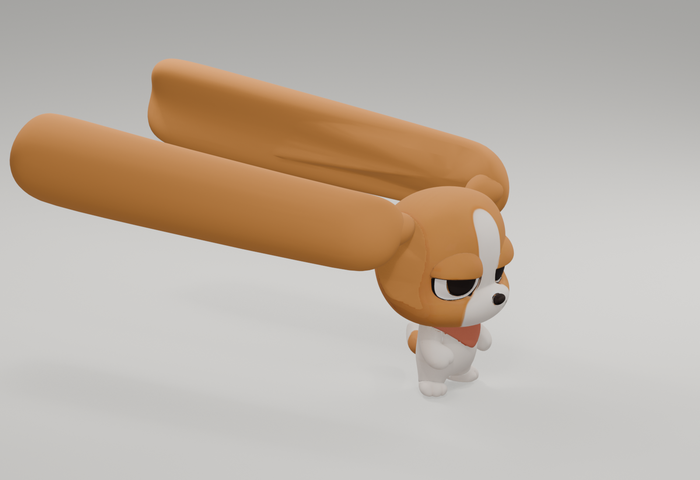
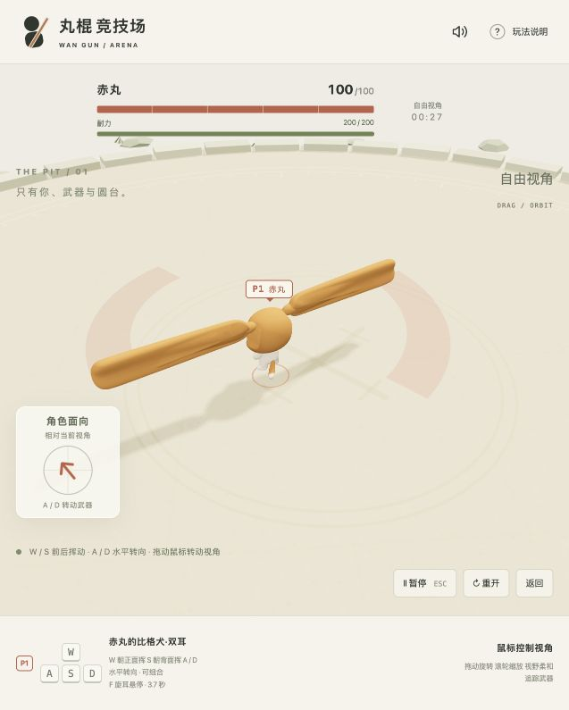

# Beagle Character Design and Development Record

Design period: 17–19 October 2026. Recorded through the timed-hover version on 19 October. The subsequent source checkpoint includes that implementation, this history and the reusable character-production skill; the stage-by-stage account below retains the original sequence of decisions.

The beagle began as a cartoon reference and became **比格犬·双耳**, a playable character whose long ears are both its weapons and its means of ordinary movement. Its final selected appearance combines the earlier smooth Tripo face and body with ears lengthened and rigged in Blender. Normal controls keep the body upright and the ears parallel; a separate F skill spreads the ears, spins the whole character and provides a short low hover.

The process involved repeated visual comparisons, several rejected motion ideas, two appearance directions, a custom rig, fitted collision shapes and integration with Wankai’s existing combat. The most important constraint throughout was that the ears had to work as real weapons. Their appearance, movement, contact and damage could not be designed independently.

This record covers the decisions, experiments, tools, implementation and lessons. It distinguishes reviewed concepts from simulated behavior, the merged source checkpoint from newer local work, and automated checks from the creator’s acceptance.

## Current local use — 20 October 2026

The beagle remains playable with the accepted upright controller. Beagle character selection is independent of equipment: sword/polearm/hammer use natural cosmetic ears, while long ears use the rigged weapon-ear controller and F/Right Shift hover. The [live game](http://127.0.0.1:5173/) now opens a full-window P1/P2 preparation stage with choices above each actual-model preview, independent Ready and shared Start/Save; Back/Escape cancels drafts. The roster includes the implemented orange tabby + cat paws: eight valid loadouts and 64 ordered pairings. The creator prefers reviewing the live game after implementation; archived videos retain their original role and scope.

The cat integration later passed the full 132-test suite. Two selection follow-ups passed 14 focused checks, then 17 focused draft/resize/camera checks plus the build; they did not rerun the historical full physics suite. See [current selection handoff](CHARACTER_WEAPON_SELECTION_IMPLEMENTATION.md) and [latest UI verification](selection-concepts/v04-preparation-stage/verification.json). The dated 17–19 October production narrative and checks below remain unchanged as history.

## Design and delivery state at the timed-hover checkpoint

| Area | Current decision |
| --- | --- |
| Identity | Large tan head, white forehead blaze and muzzle, half-lidded eyes, tiny white body, tucked paws and a restrained player-color bib. |
| Ear appearance | Smooth curved tan volumes with rounded roots and tips. The wider fluffy/scalloped direction was rejected. |
| Ear construction | One firm striking paddle per ear, attached at a head hinge. No midpoint folding joint or simulated fur. The skill adds sideways deployment at the same root. |
| Ordinary movement | W/S continuously drive forward/backward ear strokes; A/D steers simultaneously. Ground contact lifts and carries the upright body. |
| Ordinary combat | Both solid ears attack, block and clash under the shared weapon rules. They share one input phase, stamina budget and repeat-hit gate. |
| Character skill | Tap F, or P2 Right Shift, to deploy the ears horizontally, spin body and ears together, and hover slightly for five seconds including spin-up. |
| Resources | Every loadout has 200 normal stamina. The skill has no stamina cost or minimum-stamina gate. |
| Flips | Front/back flips are inactive after the creator reported the character lying down. Experiment code and videos remain historical references. |
| Delivery | The upright beagle checkpoint was pushed and merged in PR #1 on 18 October. This later source checkpoint includes the normal-control refinement, timed hover, doubled stamina and character-production skill, with the flip experiment preserved as inactive history. No packaged release was produced. |

Selected model shown in an inspection pose. The model viewer’s floor-clearance adjustment is a review convenience; gameplay movement comes from the physical controller.

## The original brief and game constraints

The creator first asked to read the project and its skills guide, then focused on a beagle and its weapon ears. A search for the popular cartoon reference was followed by the supplied expression collage. The existing [design brief](BEAGLE_CHARACTER_DESIGN.md) records a matching repost collection under 比格多栋; the supplied collage remained the actual appearance reference.

The reference’s appeal came from a broad rounded head, oversized hanging ears, a white forehead stripe, small body and unimpressed expression. The design kept those landmarks rather than combining the collage’s many costumes and props. Tan, warm white and dark facial features formed the main color groups, with a small bib providing player identification. Smooth matte volumes translated the flat cartoon into 3D.

The working name was **双耳剑客 / Beagle Ear Duelist**. The character’s attitude was a tiny, apparently unbothered dog whose ears do the demanding work. Lowered eyelids, a restrained smirk and tucked paws supported that contrast.

Wankai already used weapons for locomotion: continuous swings against the floor lift and move a fighter. There was no separate walking input. The beagle therefore needed to inherit continuous W/S drive, simultaneous A/D steering, released momentum, reverse braking, ground support, damage, blocks, clashes and stamina. A decorative ear animation alone would not fit the game.

The brief considered broad natural paddle ears, narrow saber-like ears and ribbon ears. These were written alternatives, rather than three completed production characters. Broad natural ears were selected for development because they stayed closest to the reference and made support and blocking easy to read. Their full rotation around a wide head created the main clearance problem.

## Chronology of the major decisions

| Stage | Approach and experience | Result |
| --- | --- | --- |
| Reference and brief, 17 October | Read the game context and skills guide; use the supplied cartoon to define identity, silhouette, palette and weapon requirements. | Establish broad natural ears and a small upright body as the starting direction. |
| Tool setup, 17 October | Install Blender, create an asset stage and verify a synthetic skinned export in the game’s Three.js loader. Inspect the signed-in Tripo workspace. | Establish a working authoring/export/import pipeline before producing the character. |
| Motion v01–v02, 17 October | Preview ear-driven movement. The creator found the first body rise too small and asked to see simultaneous W/S and A/D. | Increase active reach and demonstrate all four combined inputs. |
| Motion v03–v05, 17 October | Explore horizontal attacks, folding ears, rigid ears with counter-rotation, and body/ears flipping together. | Remove folding complexity and expose the rigidity of a fixed relative ear/body angle. |
| Motion v06–v07, 17 October | Compare passive hinge physics, then respond to the requirement for functional weapons by replaying the game solver. | Demonstrate powered movement, vertical/horizontal hits and a sword clash. |
| Blender model v01, 18 October | Build a complete lightweight character and custom rig directly in Blender. | Prove the rig and export pipeline, but its ear shapes felt less soft and curved than desired. |
| Tripo appearance v02, 18 October | Generate a clean single-character image, reconstruct and texture it in Tripo, download the actual mesh and inspect it in Blender. | Select a cuter, smoother head/body base. The source still needed optimization and a custom weapon rig. |
| Blender edit and fluffy branch, 18 October | Explore editing the existing source; then widen and soften only the ears, with regeneration permitted by the creator. | The fluffy/scalloped appearance was rejected in favor of the earlier smooth version. |
| Smooth production model v05, 18 October | Segment the preferred original Tripo model, clean it, lengthen its ear middles, preserve rounded ends, reproject its texture and rig it in Blender. | The creator accepted the smooth long-ear model. |
| Game integration and GitHub checkpoint, 18 October | Add the beagle as a paired character/weapon loadout, with fitted contacts, independent instances and camera support. | Upright checkpoint passed 85 tests and was pushed and merged as PR #1. |
| Playable flip extension, 18 October | Add coupled body pitch and ear dynamics while retaining A/D steering. | Passed 92 tests, but the creator reported a lying-down result. Flips were later set aside. |
| Helicopter and normal-control comparison, 19 October | Show whole-character horizontal spinning, then separate the wide spin from ordinary movement after the creator raised a coverage concern. | Approve parallel normal strokes and steering, reserving the wide rotor pose for a skill. |
| Hover and stamina revision, 19 October | Implement F hover, then replace stamina-driven holding with a fixed activation and double normal stamina. | Timed-hover checkpoint used a free five-second skill and 200 normal stamina; 100 tests and the build passed. |

Motion version numbers and model version numbers belong to separate sequences. In particular, motion v05 is an old flip study, while model v05 is the selected smooth production asset. Neither a higher number nor a newer file date by itself identifies the current gameplay design.

## Motion experiments and what each taught us

### Body lift and combined inputs

The first [motion video](beagle-ear-motion-study.mp4) used approximately 1.65 skull-heights of ear reach. It showed only about 0.22 skull-heights of body rise. The creator wanted substantial movement comparable to the existing characters and also needed to understand pressing W/S and A/D together.

[Motion v02](beagle-ear-motion-study-v02.mp4) increased active reach to 3.60 skull-heights, with the attachment about 1.43 above the feet. This permits approximately 2.17 of geometric support rise when the ears point straight down. That was a lever-length calculation, not a measured gameplay jump height. The authored preview also retained launch momentum and showed W+A, W+D, S+A and S+D.

This established that a skeleton alone could not create the missing rise. Ear length, attachment height, leverage and contact response had to support it. The later accepted model retained a 3.60-unit longitudinal ear reach, but its broader imported volumes required their own measured contacts.

Turning also exposed a contact constraint: two rigid ear tips cannot both stay fixed to the floor while their common heading turns. The preview distinguished a load-bearing tip from a tip allowed to slide instead of forcing an impossible two-point lock.

### Folding, counter-rotation and fixed relative angles

The next studies answered successive questions rather than converging immediately on one animation:

| Study | What it showed | Why it did not become the current behavior |
| --- | --- | --- |
| [v03 horizontal attacks and folding backflip](beagle-ear-motion-study-v03.mp4) | Level-ear A/D sweeps and a backflip, using two rigid sections per ear that folded in flight. | The creator questioned the extra folding complexity. It added joints and would require matching articulated contact shapes. |
| [v04 uninterrupted rigid ears](beagle-ear-motion-study-v04.mp4) | One hinge per ear; the body flipped while the hinges counter-rotated to keep long ears swept back. | The creator wanted the ears to participate in the body’s rotation rather than appear to stay aimed in one direction. |
| [v05 backflip together](beagle-backflip-together-v05.mp4) and [front flip together](beagle-frontflip-together-v05.mp4) | Body and ears completed the same revolution, without folding or shortening. | Keeping the relative ear/body angle fixed throughout flight looked rigid and insufficiently fluid. |

These clips used authored motion and ballistic flight segments. Their clearance and attachment checks established that the proposed poses were geometrically possible; they did not establish that player input and ground contacts could produce them in Wankai.

The useful distinction was between moving together and being locked together. The creator wanted coherent whole-character motion while allowing the ears to lag and change angle under momentum.

### Natural hinge motion and the return to weapon function

[Soft v06](beagle-ear-physics-soft-v06.mp4) and [looser v06](beagle-ear-physics-loose-v06.mp4) compared Blender rigid-body simulations. Each ear remained one uninterrupted paddle on a head hinge. Finite braking allowed its relative angle to change; reduced braking produced greater lag and more tumbling.

The simulations started from an external test launch and then let momentum, gravity and contacts determine the response. They were useful for comparing secondary motion, but did not demonstrate W/S-powered swings, A/D steering, ear-powered takeoff, damage or clashes. The creator clarified that the ears needed the same functions as every other weapon in the game.

The response was [functional v07 movement](beagle-functional-movement-v07.mp4) and [functional v07 combat](beagle-functional-combat-v07.mp4). An offline adapter used the current game solver with anatomical ear attachments, then Blender rendered the recorded motion. W/S applied motor drive; release preserved momentum; reverse input braked; A/D worked simultaneously. The same contact surfaces lifted the upright body, struck a dummy horizontally and vertically, and clashed with a sword.

This was the first preview in the sequence to demonstrate the full weapon-function chain through the game rules. It still used proxy character proportions and was not yet a selectable production loadout. Its measured rise of roughly 2.18–2.27 units belonged to those test setups, rather than a universal jump guarantee.

## Tools and production workflow

The project’s [skills guide](SKILLS.md) supplied the relevant practices. The creator explicitly requested character-design for the visual brief and rigging for skeleton decisions. Character design helped define landmarks, silhouette, proportions and expression; rigging helped separate physical controls from cosmetic bones. Asset planning, import checks, systematic debugging and browser inspection supported later production and verification.

The practical tool sequence was:

1. **Reference and image generation:** preserve the supplied collage, then generate a clean single-character appearance image suitable for reconstruction.
2. **Tripo through browser/computer use:** generate or segment a source, inspect its actual textured 3D result, and download GLB files with provenance and credit records.
3. **Blender and Python:** inspect the source, repair and reduce it, extend the ears, rebuild UV/texture data as needed, author the rig and export selected runtime assets.
4. **Node and the project’s Three.js loader:** verify that the exported bones, transforms and skinned vertices behave correctly after import.
5. **Game integration:** connect the rig to the physical state, contact shapes, session inputs, loadout selection and cameras.
6. **Browser review and regression checks:** inspect actual gameplay alongside numerical tests and production builds.

Blender 5.2.2 LTS was installed for Apple Silicon, with a separate project preference profile and an asset stage containing reference, working-mesh, contact-guide and presentation collections. A synthetic skinned paddle verified export, import and visible animation before character work. The [setup record](BLENDER_SETUP.md) contains the checks and launcher commands.

The workflow used browser access for Tripo and Blender’s own Python for authoring. A live Blender MCP bridge was not required. The game loads local GLBs and requires neither Blender nor a Tripo account to play.

Motion previews were rendered from generated Blender scenes and encoded with FFmpeg. Keeping source scenes, replay data, scripts and output separate made it possible to compare revisions without overwriting the selected model.

## Appearance development from Blender to Tripo and back

### First complete Blender model

[Model v01](BEAGLE_MODEL_V01.md) was authored directly in Blender. It had 10,760 triangles, four skinned meshes, two materials, thirteen bones and no texture images. It established stable head hinges, constant-length ears, player accents, a blink clip and a working GLB review page.

Its narrow 0.90-unit head provided clearance for the long paddles. That made it useful for validating construction, but the creator preferred softer curved ear volumes and a cuter face/body result. The first model remained a technical and visual comparison, rather than the final appearance.

### The original smooth Tripo candidate

A clean image was generated from the collage’s sleepy half-lidded beagle: caramel head, white blaze, short muzzle, tiny body, tucked paws, bib and compact hanging ears. The compact ears were an appearance reference, not the final weapon length.

The creator’s first “really cute” response referred to that generated concept image. The actual textured Tripo mesh was subsequently opened for review and imported into Blender. This distinction mattered because a concept image does not establish the quality or editability of a reconstructed 3D mesh.

Tripo H3.1 produced a static source with approximately 1.96 million triangles, a 4K texture and no skeleton or animation. It supplied the preferred rounded cheeks, eyelids, paws and overall appeal. It could not be used directly as the finished weapon character without ear separation, geometry reduction, rigging and gameplay work. The [v02 provenance record](../assets/concepts/beagle/tripo-v02/provenance.json) preserves the inputs and output inspection.

The creator then authorized using this exact model as the Blender base, extending the ear middles while preserving their curved roots and rounded tips. An intermediate v03 script records a Blender separation/refinement route; it was superseded by the later segmented-source workflow.

### Wider and fluffy ears

The creator requested “more fluffy and wider,” then clarified that only the ears should change and the face/body proportions should stay. Editing the reference and regenerating in Tripo was explicitly permitted if that gave a better route.

The v04 branch widened the ears and introduced fuller plush volumes with shallow scalloped contours. Tripo generated separate parts, followed by completion, retopology and texturing. This explored both a different appearance and a potentially easier editing source.

The creator then preferred the earlier model. That rejected the fluffy visual direction; it did not require abandoning the selected face or the idea of soft-looking curved ears. The [v04 record](../assets/concepts/beagle/tripo-v04/provenance.json) retains the branch and its rejection.

The lesson was that “soft” described the desired smooth volume and feel more reliably than fur texture or scalloped edges. Wider coverage also changes weapon behavior, so it could not be treated as a purely decorative edit.

### Selected smooth model v05

The final route returned to the earlier smooth Tripo v02 source. Tripo segmented that existing model into thirteen native parts. This operation did not generate a new character or repaint its face.

Blender then closed cut attachment surfaces, removed small reconstruction defects, reduced the geometry and reprojected the original paint onto a shared 2K atlas. Newly exposed inner surfaces received matching fills. The face, head, body, paws, feet and tail retained the selected source proportions, subject to the small surface differences introduced by cleanup and reduction.

Only the ears’ middle regions were extended to the 3.60-unit reach. The root and tip regions retained their local curved shape. The roots were moved slightly outboard so the full ear volume could rotate past the broad head, and rounded covers bridged the attachment seams.

| Asset measure | Original smooth Tripo source | Selected rigged v05 |
| --- | --- | --- |
| Triangles | 1,960,754 | 26,530 |
| GLB bytes | 57,300,676 | 3,489,120 |
| Texture | One 4096 × 4096 image | One 2048 × 2048 image |
| Rig | None | Thirteen bones |
| Materials | One | Three |
| Ear geometry | Compact appearance ears | Long smooth weapon ears with measured roots |

The original brief aimed for at most 20k triangles and a 1K atlas. The selected model’s measured 26,530 triangles and 2K atlas became the actual prototype budget. Those are asset measurements, not a frame-rate benchmark.

The selected sources and rebuild instructions are in [model v05](BEAGLE_MODEL_V05.md). The creator accepted this appearance before game integration.

### Recorded Tripo credit use

| Operation | Recorded charge |
| --- | --- |
| Original smooth geometry generation | 30 credits |
| Original smooth 4K texture | 20 credits |
| Fluffy Generate in Parts submission | 0 charged, using the recorded trial |
| Fluffy retopology | 35 credits |
| Fluffy texture | 20 credits |
| Segmentation of the preferred original smooth model | 40 credits |
| Total recorded for these character operations | **145 credits** |

These are historical charges from the saved provenance, rather than current Tripo pricing. The selected v05 did not require another character generation or texture-generation purchase. Later gameplay and hover work used the existing model.

## Rigging and keeping the visible ears physical

The character has a lightweight complete skeleton, with distinct responsibilities. Root and body controls carry the character and head sockets; the ear bones follow weapon state; lids, brows, jaw, paws and tail support restrained cosmetic posing. The blink clip only affects the lids, so it cannot fight the game’s ear or body controls.

Each ear has a root hinge and a firm paddle, without a midpoint or tip joint. A soft-looking mesh therefore does not imply a soft-body simulation. The current skill’s damped root lag provides follow-through while preserving a reliable striking shape. Independent left/right physical angular responses and flexible ear chains remain possible future work, rather than current features.

Coordinates were documented explicitly: Blender uses +Z up and +X forward; the exported game asset uses +Y up and +X forward. Imported rest rotations are preserved when adding procedural rotations. Ear bind pitch is −1.55 radians, so physical angles must be applied relative to that pose. Unit bind scales prevent animation from silently changing the weapon length.

The first floating-weapon transform could not simply be reused unchanged. Ordinary weapons rotate around an offset from the fighter; anatomical ears rotate around measured sockets on either side of the head. The beagle needed a shared attached-ear transform for positions, contact-point velocities and impulse response.

The selected model includes ten hidden convex authoring guides, five per ear. The runtime fits eighteen rounded capsule contacts to the actual ear surfaces. These are approximations rather than the mesh itself; the saved fit reports include their remaining gaps. Head and torso/paw hurt shapes were also adjusted for the imported body.

One authoritative pose drives the skinned model, fallback geometry, floor/rim queries, hits, blocks, clashes and camera bounds. During the skill, that pose includes pitch, sideways deployment, root lag and heading. Deployment and lag rates contribute to contact-point velocity, and intermediate samples track the changing pose. This prevents a visible rotating ear from leaving a stationary invisible weapon behind.

Both ears share one controlled swing state and one powered budget. Having two meshes does not give two copies of stamina charges, motor authority or simultaneous damage awards. Each ear still has its own attachment and contact surfaces. Pair-level hit gating handles their shared attack.

## Integration and the merged upright checkpoint

The beagle was introduced as a **paired character/weapon loadout** instead of a general character-selection system. That fit the existing armory while preserving the intended body-and-ears combination. It is available in solo, practice, split-screen duel and fixed-camera duel. In two-fighter modes, players can select it independently, including two-beagle matches; rematches retain selections.

The real imported rig replaced the primitive appearance while keeping the contact-driven rules. Independent skeleton and accent-material clones prevent one player’s pose or color changes from affecting the other. Camera bounds were extended to account for the head and long ear envelope.

The integration tested continuous W/S, simultaneous A/D, support and body travel, release/reversal, shared stamina, directional damage, blocks, clashes and all sixteen loadout pairings. The checkpoint passed 85 tests and the production build. Browser reviews included solo, two independently controlled beagles in split screen and beagle-versus-sword practice.

At the creator’s request, this source checkpoint was pushed and merged in [PR #1](https://github.com/Gumssss/Wankai/pull/1), merge commit aa3e4c6. It contained the accepted smooth model and upright movement. It did **not** contain whole-body front/back flips or the later F hover skill. This distinction explains why going backward after the merge rotated the ears while leaving the body upright.

## The playable flip experiment and its rejection

The creator then requested front and back flips with natural body/ear coupling and A/D available throughout. A local extension added body pitch, relative ear rotation, inertia and finite hinge torque through a coupled mass matrix. Ground loading could brace the body for the initial push; airborne motion allowed body rotation and changing relative ear angles.

Rotated sockets, hurt shapes, contact velocities, ground/rim response, skinning, fallback geometry and cameras followed the articulated state. The prototype did not play a guaranteed 360-degree animation or add a scripted launch impulse. Whether a full turn occurred depended on support, motor drive, stamina and momentum.

It passed 92 tests, including full turns in selected setups, combined steering, momentum reaction and inverted mesh/contact alignment. The creator nevertheless reported that the character was lying down. Landing could tumble or settle on the rounded head, and the implementation lacked reliable automatic upright recovery. The available checks had not established the desired overall control and landing experience.

The creator asked to revisit the last pushed version, then explicitly set front/back flips aside. The current game returned to an upright controller. The [flip handoff](BEAGLE_FLIPS.md), screenshots and isolated dynamics module remain an experiment archive; they must not be read as the active controls.

This was a significant process lesson: a physically plausible turn and passing numerical tests do not establish that the complete action is readable, controllable or acceptable in play. Landing and recovery deserve the same attention as takeoff and mid-air poses.

## Combining ordinary controls with helicopter motion

The next direction was horizontal ears during A/D, with continuous spinning like a helicopter. Two choices were clarified: **body and ears spin together**, and the initial motion was a **horizontal attack**. Hover was first reserved for a later character skill.

The [three-quarter](beagle-helicopter-spin-v01.mp4) and [top-view](beagle-helicopter-top-v01.mp4) videos used the approved smooth model to show clockwise/counterclockwise acceleration, coasting and reversal. Small root lag softened the transitions. They were authored motion concepts, with no opponent, damage result or hover simulation.

The creator then questioned how that wide rotor pose would combine with W/S. Automatically opening the ears on every A/D input would make ordinary steering carry a very broad attack area and would conflict with the vertical swing role.

The proposed solution separated ordinary movement from the special silhouette. The [25-second normal-controls and skill video](beagle-normal-skill-v01.mp4) showed W, S, normal D, W+D and S+A, followed by the wide spin as a distinct skill. Normal ears stayed parallel, and steering used a slower 1.15 rad/s target.

The normal sequences replayed an isolated copy of the merged upright solver with proposed steering feedback; the final skill sequence was authored animation. Keeping one camera direction and scale made the change in width easier to compare. Parallel ears reduce instantaneous width, but their long tips still have a substantial turning radius. The proposal did not eliminate that balance issue.

The creator approved this separation and requested that F now include a little hover. That instruction superseded the earlier decision to defer hover.

## Current hover implementation and stamina revision

The first local F implementation used hold-to-activate behavior with stamina drain. The creator then clarified that a skill should have a fixed lasting time and should not consume normal stamina. Normal stamina also felt too small and should approximately double.

The revised behavior is:

| Input or event | Current result |
| --- | --- |
| W/S normally | Continuously drive parallel ears forward/backward; contacts move the upright body. |
| A/D normally | Steer the heading, including during W/S, without deploying the rotor pose. |
| Tap F or P2 Right Shift | Start a five-second activation including preparation and spin-up. Settle the ears toward horizontal, spread them sideways and accelerate the whole character. |
| A/D during the skill | Choose turning direction; opposite input brakes before reversing. Skill steering costs no stamina. |
| W/S while deployed or retracting | Ordinary vertical stroke is suppressed so the ears keep the rotor configuration. |
| Release the skill key | The timed activation continues. |
| Press again while active | The timer is not extended. Holding cannot automatically repeat the skill. |
| Timer expiry | Remove lift, retract the ears, coast down and land. Normal W/S resumes after retraction. |
| Reactivation | After expiry and retraction, a fresh press can start another activation. There is no additional cooldown in this prototype. |
| Pause or reset | Pause freezes remaining time. Rematch/menu resets skill state; pending input is cleared on pause or loss of focus. |

The rotor target is up to 4.25 rad/s, with small damped root lag. Bounded lift targets feet about 0.35 world units above the floor and ramps in with deployment and rotor speed. It changes physical vertical velocity rather than adding a render-only offset. Impacts can reduce rotor speed and lift. Ordinary contact-driven vaults may rise higher than this low-hover target.

Only the skill supplies hover thrust. Normal airborne swings do not gain free travel force. Existing horizontal momentum and collision reactions continue during the skill; it has no independent flying travel control. Both solid ears retain the normal directional damage, blocking, repeat-hit and clash rules.

Normal stamina increased from 100 to **200 for all loadouts**, while health remains 100. Ordinary swing and turn costs remain 20/s and 8/s; combined input costs 28/s. Recovery remains 30/s after 0.5 seconds without normal weapon input, and fatigue still begins below 25. At full swing input, the new capacity lasts approximately ten seconds; combined input lasts approximately 7.1 seconds before reaching zero.

The five-second skill works even at zero normal stamina and is independent of normal fatigue. It costs no stamina, including A/D during activation, and normal stamina can recover while it runs. These are initial playtest values; the creator explicitly requested the resource separation, while five seconds was chosen as a starting duration.

The actual game shows a running skill countdown and 200/200 stamina. Full current details are in [the skill handoff](BEAGLE_SPIN_SKILL.md).

## Verification and the limits of each check

Verification became more representative as the work progressed:

| Check | What it established | What still needed judgment |
| --- | --- | --- |
| Motion geometry checks | Constant ear lengths, stable roots, sampled floor clearance and camera framing. | Whether the game solver could produce authored motion. |
| Blender and GLB checks | Closed surfaces, normalized skinning, correct exported axes/rest transforms, full rotations, independent clones and a noncompeting blink clip. | Appearance in the actual lighting and gameplay views. |
| Physics regressions | Contact velocities, motor/reversal behavior, support, hit gating, damage, clashes, loadout pairings and skill lifecycle. | Deliberate control, recovery feel and competitive balance. |
| Actual mesh alignment tests | Imported skinned vertices and sockets follow the same transforms as physical contacts, including spread and lag. | Rounded contact proxies still approximate detailed surfaces and grazing contacts. |
| Browser review | Actual model loading, selections, two-player instances, controls, HUD and visible timed hover. | Extended two-person play and performance under repeated sessions. |
| Creator feedback | Whether the look and action matched the intended character. | Long-term balance and production readiness require further play. |

The game baseline preserved during functional v07 had 77 tests. The integrated upright beagle checkpoint passed 85; the later flip experiment passed 92. At the 19 October timed-hover checkpoint, **100 tests passed with zero failures**, and the production build passed with the existing bundle-size warning. That checkpoint’s logs are under ignored output/stamina-timed-skill; later verification scopes are linked above.

The rejected flip result is the clearest example of why these forms of verification must stay distinct. Selected full-turn tests and correct transforms did not prevent an unacceptable lying-down outcome in the creator’s play session.

## Strategies that worked and lessons to retain

**Start with the game’s movement rule.** Ear length and sockets were gameplay dimensions. Increasing leverage addressed insufficient body rise more directly than adding skeleton complexity.

**Make the ears prove their full function early.** Passive hinge experiments helped describe lag, but functional v07 was necessary to demonstrate player drive, support, hits and clashes. A preview should state which of those functions it actually exercises.

**Separate appearance softness from mechanical flexibility.** Smooth curved volumes, matte materials and restrained root lag gave a soft impression while retaining firm weapon surfaces. Extra folds, fur contours and fully passive joints introduced other problems and were not automatically better.

**Test simultaneous inputs as a core case.** The creator repeatedly asked what happens with W/S plus A/D. Combined controls affect contact, turning radius, camera readability and stamina, so isolated single-key examples were insufficient.

**Use Tripo for a strong base and Blender for precision.** Tripo improved the selected face/body appeal; Blender supplied exact ear length, clearance, pivots, skinning and export control. Segmentation let the team return to an already liked source instead of regenerating its identity again.

**Keep source versions and make comparisons reviewable.** Preserved originals, generated scenes, front/side/back views, slow motion, fixed-camera comparisons and browser model viewers helped the creator identify the preferred result. Concept images, actual reconstructed meshes and gameplay needed explicit labels to avoid confusion.

**Drive visible art and contacts from the same pose.** An attached weapon requires shared positions and velocities, not an independent cosmetic animation. This became especially important when sideways deployment and lag were added.

**Share pair-level budgets deliberately.** Two ears increase coverage, but do not automatically justify two stamina charges, two motor budgets or duplicate damage from the same strike. Their shared attack state is an intentional simplification.

**Move a dominant silhouette into a skill when it overloads normal controls.** The rotor pose was distinctive, but too broad to apply to every steering action. Separating it kept W/S and A/D combinable while preserving the helicopter identity.

**Treat user rejection as design evidence.** The fluffy branch and playable flips both supplied useful information. Returning to the smooth source and upright controller preserved the parts that worked without requiring the creator to accept extra complexity or unstable recovery.

**Keep resource rules explicit.** The final request separated normal endurance from skill duration. Doubling the shared normal bar and giving hover its own timer addressed those two concerns directly.

**Name delivery states precisely.** “Generated,” “rigged,” “shown in a video,” “playable locally,” “merged to GitHub” and “released as an application” are different milestones. PR #1 saved the initial upright baseline; the later source checkpoint packages the timed-hover game and workflow skill. Neither source checkpoint is a packaged application release.

## Remaining work

The current appearance is selected and the current normal/skill behavior is implemented, but numerical balance remains open. Playtesting should assess ordinary steering, long-ear coverage, contact-driven rise, rotor wind-up, five-second duration, reactivation without an added cooldown, landing and the larger stamina bar against all existing weapons.

The current character stays upright and both ears share one swing coordinate. Fully independent ear responses, flexible chains, unrestricted body roll and reliable front/back flip recovery are outside the active implementation. Reintroducing flips would require a new acceptance exercise covering takeoff, steering, interruption, landing and return to a useful stance.

Rounded contacts and finite swept sampling remain approximations. Performance needs measurement; the compact asset size and successful build do not establish frame rate or memory behavior. Packaging and a public application release are also separate future steps.

The original cartoon creator and reuse terms were not established in the saved reference provenance. That remains an asset-production issue before treating this reference-derived appearance as cleared for distribution.

## Source files and review materials

### Current source and runtime

- [Editable selected Blender model](../assets/source/blender/beagle-smooth-ear-duelist-v05.blend), [rigged runtime GLB](../public/models/beagle-smooth-ear-duelist-v05.glb) and [compact appearance GLB](../public/models/beagle-smooth-appearance-v05.glb).
- [Model review page](previews/beagle-model-v05.html), [model handoff](BEAGLE_MODEL_V05.md) and [current skill handoff](BEAGLE_SPIN_SKILL.md).
- [Measured ear/contact profile](../src/beagle-profile.js), [shared skill and pose transform](../src/beagle-skill.js), [rig posing](../src/beagle-model.js), [physics](../src/physics.js) and [session/input lifecycle](../src/game-session.js).
- [Beagle gameplay tests](../tests/beagle-gameplay.test.js), [actual model tests](../tests/beagle-model.test.js) and [skill tests](../tests/beagle-skill.test.js).

### Reference and model production

- [Supplied reference collage](reference/beagle-reference-sheet.png), [original design brief](BEAGLE_CHARACTER_DESIGN.md) and [prototype plan](BEAGLE_PROTOTYPE_PLAN.md).
- [Blender/Tripo setup](BLENDER_SETUP.md), [first Blender model](BEAGLE_MODEL_V01.md), [smooth source provenance](../assets/concepts/beagle/tripo-v02/provenance.json), [rejected fluffy provenance](../assets/concepts/beagle/tripo-v04/provenance.json) and [selected model provenance](../assets/concepts/beagle/tripo-v05/provenance.json).
- [Selected model builder](../scripts/blender/build_beagle_tripo_v05.py), [import verifier](../scripts/blender/verify-beagle-tripo-v05.mjs), [contact fitting](../scripts/blender/fit-beagle-contacts.mjs) and [tracked rig/contact checks](../assets/concepts/beagle/tripo-v05/verification.json).

The large raw Tripo originals remain in the local authoring archive and are excluded from Git. The packed editable v05 rig and compact runtime GLBs are tracked. Rebuilding from original segmentation requires restoring those raw sources; import/contact checks can use the included runtime assets. Old provenance status strings describe their historical stage, so current behavior should be read from the skill handoff and this record.

### Motion and gameplay history

- [All early motion study details and videos](BEAGLE_MOTION_STUDY.md), including authored v01–v05, passive hinge v06 and functional v07.
- [Historical flip implementation](BEAGLE_FLIPS.md).
- [Helicopter preview notes](BEAGLE_HELICOPTER_PREVIEW.md) and [browser player](previews/beagle-helicopter-v01.html).
- [Normal-controls comparison notes](BEAGLE_NORMAL_SKILL_PREVIEW.md) and [browser player](previews/beagle-normal-skill-v01.html). This video predates hover and timed activation; it records the decision to separate normal controls from the wide skill.
- [Project status](PROJECT_STATUS.md), [control reference](CONTROL_SYSTEM.md), [design handoff](DESIGN_HANDOFF.md) and [dated changelog](../CHANGELOG.md).

## Reusable process for the next character

1. Read the existing movement, combat, camera and input rules before designing a new weapon-bearing body.
2. Extract a small set of identity landmarks and define which visual dimensions affect reach, support and visibility.
3. Use simple motion previews to answer specific questions, including simultaneous inputs and recovery, and label authored versus simulated behavior.
4. Prove powered movement and combat with the game solver before treating a motion study as an implemented mechanic.
5. Select the appearance base, preserve it, and use controlled edits for dimensions, clearance and rigging.
6. Measure the exported asset and derive shared contact/visual transforms from its actual geometry.
7. Verify mesh import, physics, UI and real play as separate checks; keep failures and user corrections in the decision history. For this creator, open the live game after implementation, retaining prior recordings as evidence; explain new or changed motion through a review video before integration.
8. Save an accepted source checkpoint, then record later experiments separately so the current model, controls and delivery state remain unambiguous.
