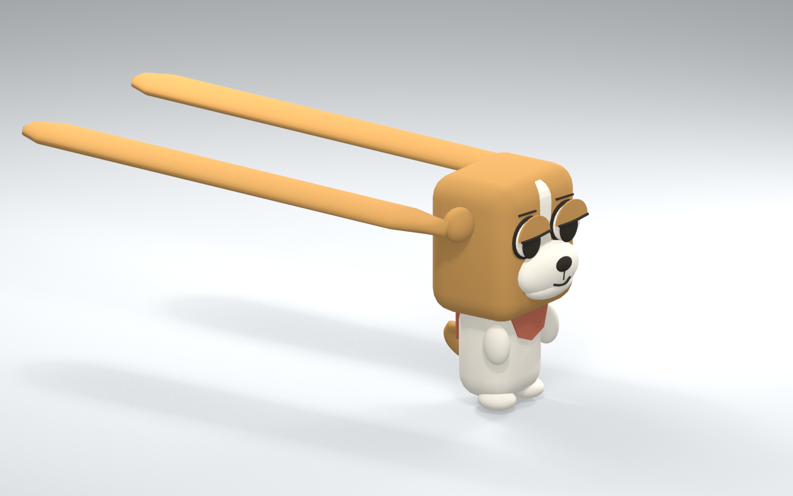

# Beagle model 01

Historical study, created 18 October 2026. Superseded by the approved [smooth v05 model and playable integration](BEAGLE_MODEL_V05.md). The descriptions below record v01 at the time of review.

An alternative [Tripo appearance candidate](../assets/concepts/beagle/tripo-v02/blender-front-review.png) was generated on 18 October after the creator authorized using Tripo credits. The single-character concept was made with OpenAI image generation from the supplied reference; Tripo H3.1 then reconstructed the mesh (30 credits) and generated its 4K texture (20 credits). The creator's “really cute” feedback referred to the concept image. The actual textured mesh was subsequently downloaded and inspected in Blender.

This candidate has smoother head, eyelid, and paw volumes, but is a static source with 1,960,754 triangles, one material, and no rig. Its compact hanging ears are appearance references, not the accepted 3.60-unit weapon geometry. Reduction, ear separation/refinement, custom rigging, and gameplay validation remain pending. The existing v01 rig and gameplay files have not been replaced. [Tripo workspace](https://studio.tripo3d.ai/workspace/texture/6db09ed1-8155-4b84-8dae-fb67085c611f) · Raw GLB and imported Blender study are retained in the local authoring archive, excluded from Git due to size · [Inputs, prompt, credits, and provenance](../assets/concepts/beagle/tripo-v02/provenance.json).

[Editable Blender source](../assets/source/blender/beagle-ear-duelist-v01.blend) · [GLB model](../public/models/beagle-ear-duelist-v01.glb) · [Interactive review page](previews/beagle-model-v01.html).



The model preserves the agreed tan head, white forehead blaze and muzzle, half-lidded eyes, tiny white torso, tucked paws, and player-color bib/back panel. It is authored directly in Blender. The two rigid paddles retain the functional preview's 3.60-unit length, 0.40-unit maximum width, 0.11-unit thickness, and sockets at `(0, ±0.66, 1.43)` in Blender coordinates.

The head is 0.90 units wide, 0.72 deep, and 1.00 high. This is narrower than the earlier construction proposal so the rotating paddles clear the core head. The minimum lateral separation is approximately 0.01 units. The small overlapping root covers intentionally conceal the hinge seams; there are no folding joints. The swept-back bind pose keeps the long ears clear of the floor without changing their length. A compact drooping idle remains a separate design question.

## Files and checks

| Item | Result |
| --- | --- |
| Body height excluding ears | 1.70 units |
| Triangles | 10,760 |
| Skinned meshes | 4: body, face, ears, accent |
| Shared materials | 2 |
| Texture images | 0; vertex-color coat plus a replaceable accent material |
| Bones | 13, under one root |
| Skin influences | 1 per vertex, normalized; rigid component weights |
| Source topology | Closed surfaces, no boundary/non-manifold edges |
| UVs | Smart-projected UV layer on every mesh |
| Runtime format | Self-contained GLB, Y up, +X forward |
| Export/import test | Passed in the project's Three.js revision 186 |
| Ear sweep | Seven angles covering −360° through +360° |
| Ear length/socket/tip errors | Below 0.000001 units after import |
| Body-pitch socket check | Passed |
| Straight-down support geometry | 2.17-unit base rise; tips reach floor |
| Skeleton cloning | Independent controls verified for two instances |
| Blink clip | Eyelid scale tracks only; no root/body/ear tracks |

The four mesh groups keep draw calls modest. The coat is matte and uses the reference palette; the accent material can switch between P1 terracotta and P2 teal. Curved strokes have welded end caps before rigging. The asset uses explicit rigid weights rather than automatic weights because the solid paddles, head, and small separate paws should preserve their volume.

The body, face, and accent geometry are provisional art. The broad beagle head still needs an in-game hurtbox and camera-fit review. This model is not registered in the armory, and the skeleton does not implement a physics controller by itself.

## Rig ownership

```text
root
└── body_pitch
    ├── head
    │   ├── L_ear_swing
    │   ├── R_ear_swing
    │   ├── jaw
    │   ├── L_lid
    │   ├── R_lid
    │   ├── L_brow
    │   └── R_brow
    ├── L_paw
    ├── R_paw
    └── tail
```

Root placement and physical body/ear motion belong to the game solver. Jaw, lids, brows, paws, and tail are cosmetic controls. Each ear has one head hinge and no midpoint or tip joint. A future body-pitch controller can rotate the whole rig around the 0.85-unit pivot while the ears receive their own relative angles.

The mesh is authored in a swept-back bind pose with **ear pitch −1.55 radians**. Each ear bone's local Y is the hinge axis. Apply a rotation of `relativeEarPitch - (-1.55)` around that local axis, composed with its imported resting quaternion. This yields the desired physical ear angle without changing the mesh or bone scale. The `body_pitch` bone also rotates around local Y. In the exported model these axes map to the game's vertical swing plane. The node verification script checks the resulting world positions rather than relying on axis labels alone.

For the upright prototype, place the model at `(player.p.x, player.p.y - CONFIG.bodyFloor, player.p.z)` and apply heading as a world-Y rotation of `-player.phi`. Preserve imported resting bone quaternions when adding control rotations. Clone a loaded character with `SkeletonUtils.clone`, and clone its accent material before giving the two players different colors.

`Beagle_Blink` is the only exported cosmetic animation. Its two eyelid tracks do not compete with root, body, or weapon control. The game can run that clip while updating ear bones from physics.

## Review views

[Front](beagle-model-v01-front.png) · [Side](beagle-model-v01-side.png) · [Back](beagle-model-v01-back.png) · [Face detail](beagle-model-v01-face-detail.png).

The interactive page provides rest, forward-strike and support poses, ear/body pitch controls, player colors, a blink, wireframe, and front/side/back inspection. It is an asset pose viewer, not a running movement simulation. It adjusts model height geometrically to keep inspection poses above the floor.

To open the local review page, run from Wankai:

```sh
npm run dev:renderer -- --port 5187
```

Then visit `http://127.0.0.1:5187/docs/previews/beagle-model-v01.html`. Another game server can keep using port 5173.

Rebuild the generated asset and studio views:

```sh
bash scripts/blender.sh --background --factory-startup --python-exit-code 1 \
  --python scripts/blender/create_beagle_model_v01.py \
  -- --replace-generated --render

node scripts/blender/verify-beagle-model.mjs
```

The generator preserves an existing source unless `--replace-generated` is supplied. Save manual art edits to another version before rebuilding. Machine-readable source and Three.js checks are in `output/blender/beagle-model-v01/`.

The supplied cartoon collage is recorded as the appearance reference. This first model is a review asset; final visual approval, gameplay integration, and shipping provenance review remain open.
