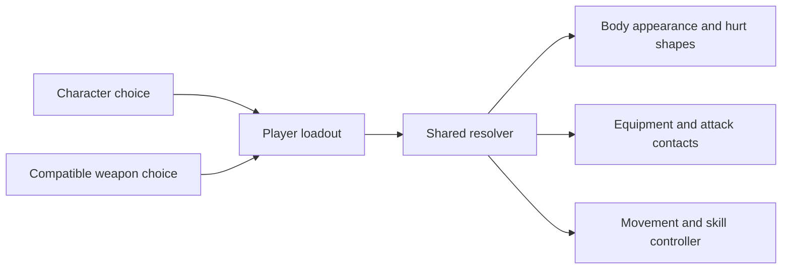

# Separate character and weapon selection

Updated 20 October 2026. **Approved full-window preparation stage implemented and locally verified.** P1 is on the left and P2 on the right, each with character/equipment choices above its own rotatable actual-model preview. Narrow screens stack complete P1 then P2 panels. This supersedes the earlier sequential boxed layout and small two-player modal; those concepts remain historical references. The implementation is not yet pushed, merged or released; playable acceptance and balance remain open.

## Relationship and roster

**Character + weapon = player loadout.** Characters own appearance, body dimensions and hurt shapes. Weapons own equipment, attack contacts, powered controls and tuning. Red and blue identify player slots independently of character.

| Character | Available weapons | Appearance |
| --- | --- | --- |
| Basic fighter / 基础丸人 | Sword, polearm, hammer | Original rounded fighter in the player's colour. |
| Beagle / 比格犬 | Sword, polearm, hammer, long ears | Compact Tripo model with ordinary weapons; accepted v05 rig with long ears. |
| Orange tabby / 橘猫 | Giant paws | Approved seated prepared-v02 model with detached giant paw controls. |

There are **eight valid loadouts and 64 ordered two-player pairings**. Long ears are beagle-specific; giant paws are cat-specific, and the cat currently supports only its approved paws. P1 defaults to basic fighter + sword; P2 defaults to basic fighter + polearm. Matching valid loadouts are allowed.

## Appearance and motion decisions

- Beagle + ordinary weapon reuses [the compact Tripo GLB](../public/models/beagle-smooth-appearance-v05.glb). It is upright and rigid: natural ears follow the body and do not follow weapon pitch. No generation or new skeleton was required.
- Beagle + long ears preserves [the accepted v05 rig](../public/models/beagle-smooth-ear-duelist-v05.glb), paired attack contacts and timed rotor skill. Changing equipment does not change the selected character identity.
- Ordinary weapons float beside the body. W/S and A/D continue to drive weapon rotation; floor contacts produce ordinary movement. Natural ears have no attack, block or powered-support contacts. There is no walking controller.
- Orange tabby + giant paws preserves the approved seated body, separate giant paws and cute expression. W/S swings both paws, A/D steers, and W+A/W+D/S+A/S+D work. S/Down paw-floor support lifts the body above its low rest hover. The accepted v06 controller uses finite motors and physical contacts; it adds no cat F/Right Shift ability. See [cat gameplay handoff](characters/orange-tabby/GAMEPLAY.md).
- F / P2 Right Shift works only with beagle + long ears: five seconds, stamina-free, bounded low hover. Ordinary equipment ignores it. Flips remain inactive.
- Full-swing clearance is measured from actual compact geometry. Beagle sword offset is 1.34 rather than the basic fighter's 1.20; polearm remains 1.35 and hammer 1.30. Physical contacts and rendering share the resolved offset. The old illustrative mockup placement is not used in gameplay.
- Existing weapon dimensions, motors, damage, 100 HP, 200 stamina and camera controls are retained. Wider beagle hurt shapes and boundary handling follow character identity even with ordinary weapons.

## Selection contract

1. Choose a mode to enter the dedicated **full-window preparation page**. Hide the arena and HUD while preparing. P1-left/P2-right panels stay visible together, with each player's choices above their model; narrow screens stack complete panels.
2. Each participating player has a separate local draft and Ready state. Compatible equipment survives character changes; incompatible equipment clears and must be selected again. An actual edit resets only that player's readiness; reselecting an unchanged choice preserves it.
3. Ready is independent and does not save or start. The shared Start/save enables only after every visible participant is ready. Solo configures P1 and preserves hidden P2; practice configures its passive dummy too. Browse mode offers Save instead of Start.
4. Final Start/save applies both canonical loadouts together through lobby-only `GameSession.setLoadouts(loadouts)`. Back or Escape discards drafts and returns to the menu. Rematch keeps committed equipment; returning to the menu permits another selection.
5. Focus the preparation heading on entry and return focus to the launching menu control on Back/Escape. Keep the mounted arena's last valid projection while its hidden container reports zero dimensions, then restore valid sizing on return.
6. Disabled cards explain owner restrictions or development status. Actual body/equipment assets load independently; loading, fallback and retry preserve selected IDs and the selected controller.

Canonical state is `{ characterId, weaponId }`. Separate catalogues feed one resolver. Legacy `"beagle"` at compatibility entry points means beagle + long ears; ordinary legacy strings mean basic fighter + that weapon. Snapshot weapon fields remain derived compatibility fields. There is no persistent save database to migrate.

## Evidence and handoff

- [Implementation, architecture, verification and remaining work](CHARACTER_WEAPON_SELECTION_IMPLEMENTATION.md)
- [Current full-window preparation screen](screenshots/preparation-stage-v04.jpg) and [verification](selection-concepts/v04-preparation-stage/verification.json)
- [Previous two-player modal screenshot](screenshots/dual-player-selection-v03.jpg), [approved image](selection-concepts/v03-dual-player/dual-player-selection-v03.png) and [verification](selection-concepts/v03-dual-player/verification.json)
- [Cat integration, approved motion and actual-game evidence](characters/orange-tabby/GAMEPLAY.md)
- [19 October chaptered ordinary-weapon before/actual-game videos](previews/character-weapon-motion/index.html) and [dated verification](previews/character-weapon-motion/verification.json)
- [Historical boxed selection screen](screenshots/character-weapon-selection.png)
- [Actual beagle + sword gameplay](screenshots/beagle-sword-loadout.png)
- [Actual mixed-loadout duel](screenshots/beagle-mixed-loadouts.png)
- [Original boxed-selection reference, unchanged](selection-concepts/v01/selection-reference-original.png)
- [Historical standalone concept](previews/character-weapon-selection-v01.html) and [approved right-model layout](selection-concepts/v02/01-character.png)

The 19 October before videos use actual models with an isolated baseline solver and measured body/attachment adaptations. After videos capture the real App, session, solver and renderer using labelled scripted inputs and independent contact fixtures. The cat's complete v07 movement review was approved before integration; human playable feel and balance remain open. The creator reviews already implemented changes in the live game and does not need a new recording shown for this UI follow-up. Earlier v01/v02 layouts and v03 modal screenshots remain dated, superseded studies.
