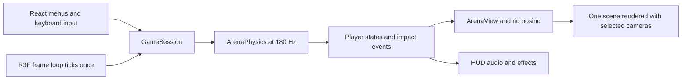

# Wankai Collaborator and Agent Handoff

**Live integration review:** browser checks pass for intro entry/Escape return, yellow defaults, independent preparation/cancellation, fixed yellow combat/rematch, split beagle/cat controls and hover ownership, pause, practice, solo polearm and mobile bounds. No page errors; existing clock-deprecation warnings remain. [Combined verification and screenshots](../assets/concepts/integration-2026-10-22/verification.json).

**Combined checkpoint — 22 October 2026:** integrates the yellow character/yellow staff and animated startup/menu from latest main (`ae91c42`) with the Colosseum, Roman-inspired floor and approved arena cameras (`701b7d5`). All four characters and nine valid loadouts are retained, including the new yellow defaults. Both sides of the menu/camera conflicts are preserved. The shortened 2.00-unit polearm now scales its measured contacts with the visible model; a regression reproduces and prevents the former invisible-tip hit. Fresh checks: **179/179 tests and production build pass** (existing chunk-size advisory). [Integration/merge status](https://github.com/Gumssss/Wankai/pull/4). Earlier local-only and branch-only notes below describe their dated checkpoints.

**Fresh branch verification — 21 October:** `npm test` passed **158/158**, `npm run build` passed with the existing large-chunk advisory, the prepared-GLB verifier passed (613 floor samples, zero misses), and the staged diff check passed. Runtime source/assets match the approved working snapshot. See [delivery verification](../assets/concepts/colosseum/delivery-v01/verification.json). No new browser playtest or new character integration is claimed for this publication-only task.

**Arena/camera delivery — 21 October 2026:** the creator requested a separate push of the latest arena and camera updates, leaving integration with another contributor's future character for later. Branch `feat/arena-camera-updates` is based on merged `main` at `55857a0`; the orange cat is the creator's existing work and is already in that baseline. The delta contains the Colosseum/environment sources, Roman-inspired floor, approved split/fixed cameras, matching contacts/tests and evidence. This delivery does not merge or release. Earlier local-only statements below describe their dated checkpoints.

**Roman-inspired floor texture implemented — 21 October:** all modes use `public/textures/colosseum-roman-floor-v01.jpg` through dedicated floor material/planar UVs. Preserve the original GLB and wall atlas. Current cameras and physics are unchanged. Original-floor fallback and pending-load/resource cleanup are covered by tests. All 158 tests and build pass; actual mode/combat/rematch checks completed. See [Colosseum handoff](environments/colosseum/HANDOFF.md) and `assets/concepts/colosseum/floor-pattern-v02/` for source, exact imagegen prompt, comparison and implementation evidence. No Git delivery.

**Fixed-camera v09 approved — 21 October:** the creator approved using the latest lower, closer preview in the game. Fixed duel uses perspective FOV 55°, eye [22.802009683082648, 12, 9.77228986417828] and target [0, 1.4, 0]. Its rendered pair rotates 45° anticlockwise about the arena centre as one display frame, including bodies, weapons and effects; HUD projection and camera cutaway targets use the same frame. Physics positions, headings, velocities and solver remain identical to split-screen, and rematches retain the view. The larger arena stays at uniform scale 3 / radius 19.35 / podium contact height 2.52. The camera stays fixed during play and impacts; solo, split and practice retain their settings. This tighter view can crop fighters and weapons near the foreground or side rim. See [Colosseum handoff](environments/colosseum/HANDOFF.md) for the accepted preview, implementation evidence and visibility limits. All 155 tests pass, production build passes with its existing chunk-size advisory, and diff check passes. Normal-game Chrome review verified both players’ swing/turn inputs and rematch; Chrome and the open in-app game tab show the implemented fixed view without console errors. Local work only; no commit/push.

**Fixed-camera preview v05 approved and implemented — 21 October:** the creator approved the larger shared-camera view after raising it, moving it 12.5% closer and orbiting 45° anticlockwise. Local fixed duel now uses perspective FOV 55°, eye [30.88677987096443, 24, 13.237191373270472] and target [0, 1.4, 0]. Its visual model and physical boundary match split-screen at uniform scale 3 / radius 19.35 / podium contact height 2.52. The camera stays fixed during play and impacts. Solo, split and practice retain their camera settings; practice retains the smaller arena. See [Colosseum handoff](environments/colosseum/HANDOFF.md) for implementation evidence and visibility limits. No commit/push.

**Closer split-camera preview approved — 21 October:** creator approved applying the exact 12.5%-closer preview. Local split defaults in `src/free-camera.js` are distance 21 and pitch `Math.asin(Math.sin(0.35) * 10.5 / 21)` (approximately 0.17230016); baseline eye height exactly matches the original 4.80042698 above the fighter. FOV, azimuth, independent orbit/fitting, cutaways and all other mode cameras retain their settings. The preceding distance-24 lower trial is superseded and remains in camera-study history. All 34 focused checks and the production build pass (existing chunk-size advisory); the normal game was checked in Chrome and the implemented camera image was saved. No commit/push.

**Colosseum local extension — 20 October:** Blender-prepared arena and explicit floor/rim mapping are now implemented locally, preserving mode radii and using uniform whole-building scaling plus per-camera cutaways. Full suite 149/149 and build pass. Start with [Colosseum handoff](environments/colosseum/HANDOFF.md) for source/profile, evidence and caveats. This extension is uncommitted/unpushed and does not change earlier Git delivery records.


## Current local delivery — 20 October 2026

**Delivery-branch update:** the creator has now requested a GitHub push. The delivery branch is `feat/orange-tabby-preparation`, based on `a591070fff8a64709dd0d775c140988e3d9b4ff1`; its complete current suite passed **143/143 tests** and `npm run build` passed before committing. The build retains its existing chunk-size advisory. The PR's actual head identifies the delivered revision. Merge remains assigned to the creator's integration agent; no merge or packaged release is part of this push. Local-only descriptions in the dated implementation checkpoints below describe their original stage.

Orange tabby + cat paws is implemented locally after the creator approved the complete v07 move video. The exact prepared-v02 export is in `public/models/orange-tabby-prepared-v02.glb`; `orange-tabby-profile.js` preserves the approved v06 contacts and controller. There are eight valid loadouts / 64 pairings. Cat currently supports its approved giant paws; existing basic/beagle equipment and beagle skill remain intact. Read [cat GAMEPLAY](characters/orange-tabby/GAMEPLAY.md) for current evidence, checks and outstanding playable acceptance.

Selection now has its own full-window preparation page: P1 left/P2 right, each with choices above an actual-model preview, independent Ready buttons and one shared Start/save. Back/Escape discards drafts and returns to the menu. See the [current screenshot](screenshots/preparation-stage-v04.jpg), [implementation](CHARACTER_WEAPON_SELECTION_IMPLEMENTATION.md) and [screen verification](selection-concepts/v04-preparation-stage/verification.json). Cat integration passed 132 tests at its checkpoint; the following layout and preparation-page passes ran 14 and 17 focused checks respectively. These are dated/scoped results, not a new full-suite total. No push/merge/release is implied.

Updated 20 October 2026 against local source and existing verification records. Repository: [Gumssss/Wankai](https://github.com/Gumssss/Wankai). Default integration branch: **main**. This file is the starting brief for a collaborator and their coding agent: it explains the game, current behavior, code ownership, development commands, accepted decisions, open work and delivery process.

**Extensions after PR #2:** separate character/weapon catalogues, orange-tabby gameplay, the preparation page, skill refinements and current records are collected on `feat/orange-tabby-preparation` for GitHub delivery. They remain unmerged. Read the [selection implementation handoff](CHARACTER_WEAPON_SELECTION_IMPLEMENTATION.md) for the API, eight valid loadouts and verification limits. The prior merged baseline is `a591070fff8a64709dd0d775c140988e3d9b4ff1`. Preserve unrelated work when preparing or integrating a delivery.

The initial smooth beagle integration was merged in [PR #1](https://github.com/Gumssss/Wankai/pull/1). The timed-hover game update, reusable character-production skill and this handoff belong to [PR #2](https://github.com/Gumssss/Wankai/pull/2). Check that PR and the current remote main before assuming a particular checkout contains the update. Gameplay commit **5bf5ae7** is the tested timed-hover baseline; later commits in that PR add handoff/documentation work.

## Current cutoff and merge owner

**Creator instruction, 20 October 2026: the creator will merge using an integration agent on their own side.** Contributing agents prepare and verify their assigned changes, update the handoff and provide the branch/PR and tested revision when GitHub delivery is authorized. The creator's integration agent owns the combined review, conflict resolution, final checks and merge into `main`. Contributors hand over for that integration step rather than merging their own contribution.

The cutoff handed to that agent is:

- **Implemented locally:** enabled cat + giant paws; independent character/weapon catalogues; simultaneous P1/P2 selection; the full-window preparation page; and the stage-scoped `game-character-pipeline` update with live-game delivery and UI-only verification rules. Preserve approved assets, controller versions and unrelated work.
- **Delivery state:** the last merged baseline is PR #2 at `a591070fff8a64709dd0d775c140988e3d9b4ff1`, verified against `origin/main` before this delivery. The extensions are collected on `feat/orange-tabby-preparation` at the creator's subsequent push request. Use the actual remote branch/PR head and report its SHA; do not treat the historical baseline as the tested incoming head. The latest pre-commit check passed the complete 143-test suite and production build.
- **Evidence:** [cat integration and limits](characters/orange-tabby/GAMEPLAY.md), [selection implementation and dated checks](CHARACTER_WEAPON_SELECTION_IMPLEMENTATION.md), [latest preparation verification](selection-concepts/v04-preparation-stage/verification.json), and [skill scope/validation](SKILLS.md#stage-scoped-pipeline-and-applied-refinements). The 132-test integration checkpoint, 14-check layout pass and 17-check preparation pass are separate recorded runs. The integration agent verifies the actual combined revision before merging.
- **Remaining work:** creator playtest of feel, lift, cameras and balance; native Electron verification of the latest page; and deferred performance/loading work when assigned. Existing recorded evidence remains available, while implemented changes are presented for review in the live game. Do not restart Tripo/Blender or revive deferred features merely to merge.
- **Current endpoint:** the earlier documentation-only task is complete; the creator subsequently authorized a GitHub push. Commit/push this delivery branch and prepare its PR for the creator's integration agent. Stop before merging or releasing. The receiving agent reviews the actual combined revision and repository requirements before its separately assigned merge.

Before handing over a contribution, record its branch/PR and exact head when available, changed behavior/files, commands and results for that revision, evidence, conflicts/open decisions and any source assets that remain outside Git. If a value does not exist yet, say so instead of inventing it. Reuse this document and existing task/character records; a separate cutoff file is not required.

## Use the character skill from this cutoff

The portable instructions are [skills/game-character-pipeline/SKILL.md](../skills/game-character-pipeline/SKILL.md). If the receiving agent has the skill installed, mention `$game-character-pipeline` and state the endpoint. If it is not installed, tell the agent to read that repository file and the references relevant to the task; reading the checked-in source does not require an installation step. The latest source remains part of the local handover until delivered, so a clone of the prior merged baseline does not contain this revision.

For example:

> Use $game-character-pipeline to prepare only the front, side and back reconstruction images from the selected reference. Preserve the identity, deliver the three-view packet and stop before Tripo.

> Read skills/game-character-pipeline/SKILL.md and docs/characters/orange-tabby/HANDOFF.md. Resume only the task I assign from the approved model/controller and existing approvals. Preserve the current implementation, record a checkpoint at the requested endpoint and open the game for implemented behavior review.

The skill supplies the method; the character handoff/manifest and [project status](PROJECT_STATUS.md) supply the current artifacts, approvals and unfinished work. A single-image request stops at one image; a model-only request stops before gameplay integration; an approved-asset integration resumes directly; an authorized playable-character request can continue across stages. UI-only work uses screen/interaction evidence while retaining unchanged motion. See the [collaborator skill quickstart](SKILLS.md#collaborator-quickstart) for more ready-to-use examples. Invoking the character pipeline does not assign merge ownership or authorize publishing.

## Start here

Wankai, displayed as **丸棍竞技场**, is a small offline 3D physics fighting prototype. Two people share one keyboard on a Mac. The defining rule is that **the weapon is also the means of ordinary movement**: powered swings push against the floor and carry the fighter. There is no separate walking controller.

The current local source has independent basic-fighter, beagle and orange-tabby identities; three common floating weapons, beagle-only long ears and cat-only giant paws; a full-window two-player preparation page; four play modes; health/stamina; physical hits/blocks/clashes; independent duel cameras; audio/effects; pause and rematch. The next goal is deliberate, readable movement and combat for first-time players and hands-on acceptance of the implemented selection and cat movement.

The runtime uses Electron, React, React Three Fiber, Three.js and a custom fixed-step solver. Tripo and Blender create assets outside the running game; players do not need those tools, an AI account or API credentials. There is no online networking, AI opponent, controller support, progression system or packaged installer in this checkpoint. Windows/Linux have not been verified.

Read this file first, then [current status](PROJECT_STATUS.md) and the source/tests for the assigned task. Use [controls](CONTROL_SYSTEM.md) for detailed mechanics and [design handoff](DESIGN_HANDOFF.md) for decisions. Historical studies explain earlier ideas; they do not override current implementation or later user decisions.

## Get a working development environment

The verified baseline is macOS with **Node.js 22.12 or newer**, npm and Git. The lockfile selects dependency versions. Use npm rather than switching package managers or updating dependencies as part of an unrelated task.

For a new checkout:

```sh
git clone https://github.com/Gumssss/Wankai.git
cd Wankai
npm ci
npm start
```

The first install needs network access and downloads Electron. After dependencies are installed, normal launch/play uses local assets. Do not start by opening index.html directly.

| Command | Purpose |
| --- | --- |
| npm start or npm run dev | Start the Vite renderer and Electron development window together. |
| npm run dev:renderer | Start only the browser renderer at http://127.0.0.1:5173/. |
| npm run dev:renderer -- --port 5187 | Optional separate browser-review port; 5187 was used during beagle development, not a required project setting. |
| npm run dev:electron | Open Electron against the normal 5173 renderer. |
| npm test | Run the Node physics/session/camera/model regression suite. |
| npm run build | Build the renderer into dist/. |
| npm run preview:electron | Open the existing dist/ build in Electron; build first. This is a local preview, not an installer. |

Electron's development URL is fixed to 5173 in electron/main.cjs, and Vite uses strict port binding. An alternate browser port does not automatically change Electron. Check for an existing server and which checkout it serves before starting another or terminating somebody else's process.

On an existing checkout, inspect git status before switching branches or updating. Preserve someone else's changes. With a clean checkout, update main using git fetch origin and git pull --ff-only origin main. Use a separate checkout/worktree when another agent is actively editing the same files.

Blender is needed only for asset authoring. The existing setup uses Blender 5.2.2 LTS on Apple Silicon, a project launcher and bundled Blender Python. Other machines should verify their installed version and GLB export/import rather than assume the owner's application path exists. [BLENDER_SETUP.md](BLENDER_SETUP.md) records the working conventions and checks.

## Current player behavior

### Modes and controls

| Mode ID | Menu meaning | World and view |
| --- | --- | --- |
| duel | 双人对战 · 分屏视角 | One match, two independently controlled rear cameras; arena radius 19.35. |
| duel-fixed | 双人对战 · 固定视角 | Approved lower/closer v09 perspective shared view, starting pair rotated 45° anticlockwise; arena radius 19.35. |
| practice | 木桩练习 | P1 fights an idle P2 dummy using the shared view; radius 6.45. |
| solo | 单人自由视角 | One fighter, mouse orbit/zoom and radius 19.35. |

Each mode enters the full-window preparation page. P1 is on the left and P2 on the right, each with character/weapon choices above their actual-model preview; narrow screens stack complete player panels. Players draft independently and can choose matching loadouts. Each presses Ready, in either order, then the shared Start/save commits both atomically. Ready alone does not commit or start; changing a choice resets only its player's readiness. Back/Escape discards drafts, restores the menu trigger's focus and leaves committed choices unchanged. Rematch retains committed choices. Solo configures P1 while preserving hidden P2; practice configures its passive dummy too. Defaults are basic fighter + sword against basic fighter + polearm. Preparation hides the mounted arena/HUD and blocks weapon inputs; returning restores the arena's valid sizing.

| Action | P1 | P2 |
| --- | --- | --- |
| Continuous frontward swing in the facing plane | W | Up arrow |
| Continuous backward swing | S | Down arrow |
| Left/right weapon heading | A / D | Left/right arrows |
| Independent split-screen camera rotation | Q / E | Period / Slash, without Shift |
| Beagle + long ears timed-hover skill | F | Right Shift |
| Pause | Esc | Esc |
| Return from preparation, discarding drafts | Esc / Back button | Shared action |
| Rematch during play | R | R |

W/S select a continuous rotation direction, not a fixed up/down pose. Both axes work together. From overhead, W swings toward the front and S toward the back; continuing through downward contact can raise and carry the body. Release retains momentum under gravity/damping; opposite input brakes before reversing. Opposite keys on the same axis cancel powered input. Airborne ordinary swings add no independent travel force.

Weapon heading and camera heading are separate. Do not make A/D rotate the camera as an incidental change. Split-screen renders one simulation twice; it must not tick the game separately for each viewport. Mouse camera controls belong to solo. Loss of focus or a hidden tab clears input and pauses.

The split cameras start behind each fighter with the closer preview approved on 21 October: a 15-degree offset, approximately 0.17230016-radian orbit pitch, 55-degree field of view and 21-unit distance. Pitch is derived from `asin(sin(0.35) * 10.5 / 21)`, so the original baseline eye height remains exactly 4.80042698 units above the fighter. Framing guards protect the player's own fighter; they do not guarantee the opponent and full weapon are always visible.

### Loadouts and combat

Common weapons work with basic fighter and beagle. Beagle uses its natural-ear rigid model for them. Character owns body hurt shapes/boundaries; equipment owns attack contacts and motors.

| Weapon ID | Role and current distinctions |
| --- | --- |
| sword | Short reach, fast response. Axis limit 6.1 rad/s. Guard geometry participates in contact; decorative flame detail does not add coverage. |
| polearm | Longer reach. Axis limit 4.25 rad/s. Measured shaft/collar/blade/barb contacts follow the local asset. |
| hammer | Slower response and greater inertia. Axis limit 3.4 rad/s. Solid head participates in support/hits/clashes and receives a 30% head-damage bonus; hanging cloth is cosmetic. |
| long-ears | Beagle-only long head-mounted weapon ears, upright strokes and timed rotor/hover. Legacy `beagle` input maps to beagle + long ears. |
| cat-paws | Orange-tabby-only detached giant paws. Paired W/S strokes and A/D heading, including all four combinations; floor support lifts the seated cat above low rest hover. No additional skill. |

All eight valid loadouts and 64 ordered pairings are enumerated in tests. Orange tabby currently supports only cat paws. F/Right Shift requires beagle + long ears; natural beagle ears are cosmetic and cannot attack, block or provide powered support.

Current speed limits are the approved half-speed trial, with visual reach and acceleration/braking retained. They remain balance values, not final competitive tuning. Ordinary weapon parameters live in WEAPONS; beagle geometry/profile lives separately.

Each fighter has **100 HP** and **200 stamina**. Ordinary swing input costs 20 stamina/s, turning costs 8/s and both together cost 28/s. Recovery starts after 0.5 seconds without normal weapon input at 30/s. Below 25 stamina, powered strength/driven speed weakens toward 40% at zero; braking, passive motion, support and blocking remain. Camera input is free. Paused/countdown/hit-freeze periods do not advance the physical stamina clock.

Damage uses incoming relative contact-point speed and recent net drive acceleration. Light contacts below 1.65 m/s do no damage. Base damage is capped at 34 before the hammer-head multiplier; the resulting hammer head cap is 44 after rounding. Head and torso receive the same damage. Pure yaw-driven horizontal impact gets 50% of equivalent vertical damage; mixed contacts blend actual incoming yaw/pitch/translation contributions, including inertial hits after key release. Do not substitute current key state for contact motion.

Repeated overlap is gated rather than awarding damage every step. Paired ears or paws share one logical attack gate and ordinary stamina budget. Clear weapon clashes physically deflect both weapons and apply backward recoil opposite each fighter's own facing, with separation/cooldown rearming. Do not use the camera direction or collision normal as a replacement for that requested recoil direction. Body hits and clashes have different feedback; extra clash pause/readouts remain unimplemented.

Arena boundaries constrain bodies; falling off is not the win condition. A fighter loses at zero HP. The practice dummy stays passive, retains at least 1 HP and recovers health after it has not been hit for 2.5 seconds.

### Beagle behavior to preserve

The accepted appearance is the earlier smooth Tripo source, refined into model v05 in Blender. Preserve the round face, markings, proportions, curved ears and rounded tips. The fluffy/scalloped branch was rejected.

Normal W/S rotates parallel ears at measured head sockets; A/D can steer simultaneously with a normal target of 1.15 rad/s. Ground contacts produce ordinary lift/travel. The body stays upright.

Tap F, or P2 Right Shift, to start **five seconds including preparation/spin-up** of full sideways deployment, whole-body-and-ear rotation and low hover. Rotor speed targets up to 4.25 rad/s; feet target about 0.35 world units above the floor. Bounded physical lift depends on deployment/rotor readiness, and impacts can alter it. The timer continues when the key is released. Repeated presses cannot extend it, and holding cannot automatically recast. Expiry removes lift, retracts the ears and lands; a fresh edge after retraction can activate again. There is no added cooldown in this prototype.

The skill and its A/D steering cost **no stamina**, work at zero stamina and do not weaken with ordinary fatigue. Ordinary stamina can recover during it. W/S strokes pause while deployed/retracting. Pause freezes the timer; rematch/menu resets it. Other loadouts ignore the skill keys.

**Front and back flips are inactive.** The user reported the articulated experiment lying down and set it aside. src/beagle-dynamics.js and the old flip studies remain historical/isolated test material; the production controller does not import that module. Do not restore flips because an older document or video requests them.

The rigged GLB, fallback geometry and physical capsules use the same pitch/spread/lag/heading transform. Root lag is small controlled secondary motion, not an unrestricted floppy chain. The two ears have separate roots/contacts but share their ordinary swing command, motor budget and repeat-hit handling. Full details are in [BEAGLE_SPIN_SKILL.md](BEAGLE_SPIN_SKILL.md) and [BEAGLE_MODEL_V05.md](BEAGLE_MODEL_V05.md).

### Orange-tabby behavior to preserve

The accepted cat is seated and floats at a low resting height between much larger detached paw weapons, without visible arm connectors. W/S (P2 Up/Down) pitches both paws; A/D (Left/Right) steers their common heading, including W+A, W+D, S+A and S+D. S/Down paw-floor support must visibly raise the body; rest hover is separate from this contact-driven lift. Release retains inertia and returns through descent/recovery. The pair uses existing stamina, hit gates and clash/recoil behavior; F/Right Shift is ignored. Preserve the exact prepared-v02 runtime GLB, v06 contact/controller profile and approved v07 movement acceptance. [GAMEPLAY](characters/orange-tabby/GAMEPLAY.md) records current runtime evidence; earlier cat concept studies are historical.

## How the code works



| File or area | Responsibility and editing guidance |
| --- | --- |
| src/main.jsx | Mounts the React application. |
| src/App.jsx | Owns the shared GameSession instance, menu/preparation-screen transition, HUD/help/dialogs and browser keyboard/focus bindings. Keeps the arena mounted and hidden while preparing. Uses session snapshots for React UI. |
| src/game-session.js | Input mapping, selections/mode, lobby/countdown/playing/paused/ending/result states, fixed-step accumulator, hit-freeze, audio/events, resets and snapshots. |
| src/physics.js | Authoritative game rules: CONFIG, WEAPONS, STAMINA, CLASH, contact transforms/velocities, motors, ground/rim/body impulses, attacks, clashes, damage and repeat-hit rules. Keep it renderer-independent. |
| src/ArenaCanvas.jsx | R3F Canvas and frame bridge. Calls session.tick once, loads local GLBs, updates the view and renders one/two viewports. Handles renderer context loss and lifecycle. |
| src/scene.js | ArenaView: scene/fighters/fallbacks, model attachment, trails/particles, camera orchestration, projection and resource disposal. Hidden/invalid resize dimensions retain the last valid framing. Visuals follow physics rather than moving the solver. |
| src/free-camera.js | Solo/split orbit, facing-independent camera input, tracking, resize and framing protection. |
| src/character-catalog.js, src/weapon-catalog.js and src/loadouts.js | Independent catalogues and shared validation/resolution. Canonical selections are `{ characterId, weaponId }`; snapshots derive legacy weapon fields. |
| src/Armory.jsx, src/armory-drafts.js, src/LoadoutPreview.jsx, src/model-assets.js and src/armory.css | Full-window per-player drafts/readiness, shared atomic confirmation, combined actual-model previews, fallback/retry and disposal. |
| src/character-attachments.js | Generated compact body bounds and measured ordinary-weapon clearance offsets. Regenerate with the measurement script after relevant asset changes. |
| src/weapon-visuals.js | Measured native model axes, grip alignment and continuous yaw/pitch orientation. Do not infer pivots from a screenshot. |
| src/beagle-profile.js | Generated measured model name, sockets, dimensions, motor values and eighteen fitted ear capsules. Regenerate after relevant geometry edits. |
| src/beagle-skill.js | Active timed skill lifecycle, hover and authoritative beagle point transform/Jacobians, including spread and lag rates. |
| src/beagle-model.js | Independent skeleton/material instances, imported rest transforms, game-driven posing, blink and procedural fallback. |
| src/orange-tabby-profile.js and src/orange-tabby-model.js | Approved runtime GLB, fitted cat/paw contacts and bounds, independently instantiated model/materials and shared actual/fallback posing. |
| src/audio.js and src/style.css | Synthesized Web Audio feedback and application styling/layout. No downloaded runtime audio service. |
| electron/main.cjs | Sandboxed desktop shell and dev/built entry. Node integration is off; context isolation and sandboxing are on. No gameplay IPC bridge. |
| tests/ | Node tests for physics, contacts, loadouts/readiness, damage/stamina, recoil, sessions, cameras/hidden resize, actual GLB posing, beagle skill and cat gameplay. |
| scripts/blender/ and scripts/preview/ | Authoring, asset verification, contact fitting and offline motion studies. These are not required to play. |
| public/models/ | Self-contained runtime GLBs loaded locally. |
| assets/source/ and assets/concepts/ | Editable authoring sources, reference/provenance and measured reports; some large raw files are intentionally archived outside Git. |

GameSession clamps large render deltas and accumulates time into CONFIG.step = 1/180 second, with a bounded substep count. ArenaPhysics steps once per accumulated tick. Rendering speed or viewport count must not change the physical clock.

Weapon/body contacts use positions and point-velocity derivatives so impulses affect translation and rotation together. Current weapon contacts are rounded capsule approximations. Between-pose sampling helps catch fast crossings, including ear deployment/lag, but is bounded and does not guarantee every grazing contact. Do not inflate all hitboxes to mask a transform or sampling error.

The game world uses +Y up. Native weapon axes are asset-specific; the beagle is authored +X forward, with Blender +Z up converted to glTF +Y up. Preserve bind/rest quaternions and correct origins. A visual skeleton supplies deformation controls, not a physics controller by itself.

## Asset and character production rules

New character production uses the included [game-character-pipeline skill](../skills/game-character-pipeline/SKILL.md). Read that file directly if the skill is not installed. The eight older project skills in the owner's parent workspace are not automatically part of a GitHub clone; the included pipeline is portable and links to its own references.

For discoverable installation on another agent's machine, run the following from the repository root. It creates a new skill folder and deliberately refuses to overwrite an existing one:

```sh
python3 - <<'PY'
import os
import shutil
from pathlib import Path
codex_root = Path(os.environ.get('CODEX_HOME') or (Path.home() / '.codex'))
destination = codex_root / 'skills' / 'game-character-pipeline'
shutil.copytree(Path('skills/game-character-pipeline'), destination)
print(destination)
PY
```

If already installed, inspect/update that copy deliberately. Invoke it as **$game-character-pipeline**. It can use available character-design, create-game-assets, rigging, model-loading and debugging tools; do not require an unavailable MCP bridge when Blender Python or signed-in browser access is usable.

The user's required workflow is:

1. Read the actual game and preserve the selected reference. Write a provisional design brief, manifest and functional plan before generation.
2. **Always use videos to present the understanding of every move**, including familiar controls, combinations, abilities, transitions, landing and recovery. Use cheap blockouts/solver replays before final modeling; label authored concepts and test-launch forces honestly.
3. Approve the direction/motion and exact reconstruction packet. Always prepare consistent separate front, side and back images from the selected seed before a new Tripo generation; inspect all three and current Tripo slots/settings.
4. **Always generate a new production character base in Tripo.** Review the actual downloaded 3D candidate, not just the concept image. Reuse an approved Tripo base for later edits instead of regenerating identity unnecessarily.
5. Refine/optimize/rig in Blender. Keep originals and visual locks, document coordinates/pivots/control ownership, fit contacts, reimport with the real loader and show move videos. Review the finished asset before integration.
6. Implement the accepted character/loadout and verify it in the actual game, covering contacts, multiple instances, modes, reset paths and complete-action recovery. Preserve required motion/gameplay evidence. The creator's later review preference is to open the working game after implementation instead of presenting another recording; do not require a redundant video presentation when the creator chooses live review.
7. Update the design, plan, motion/video record, manifest/provenance, model/runtime handoff, verification and history. Reuse existing documents for small changes.

User approval and credit authorization persist within their actual scope. Prepare concrete artifacts before requesting an unresolved decision, combine reviews where useful and do not ask repeatedly for routine cleanup/export/test permission. A prior beagle credit authorization is not an unlimited budget for a new character. Do not silently bypass Tripo or required videos if tooling is unavailable.

Use simplified runtime contacts rather than high-detail render meshes. Body-mounted weapons need anatomical sockets, while deliberately detached weapons can use their approved constraints. More appendages must not automatically multiply damage, stamina charges or motor power. Keep authored cosmetic tracks from overriding physically controlled bones.

Beagle + long ears uses `public/models/beagle-smooth-ear-duelist-v05.glb`, with the editable packed rig at `assets/source/blender/beagle-smooth-ear-duelist-v05.blend`. Ordinary beagle equipment uses `public/models/beagle-smooth-appearance-v05.glb`; orange tabby + paws uses `public/models/orange-tabby-prepared-v02.glb`. The original large beagle Tripo downloads are excluded from Git; rebuilding from raw segmentation requires restoring them. Included GLB/contact verification works without those raw sources.

Existing static-weapon preparation scripts assume inspected static GLB layouts and reject skins; they are not a universal character optimizer. Python 3 and Pillow support those scripts. New rigs need the Blender/skinned-GLB path instead.

## What is finished and what remains open

| Status at this checkpoint | Meaning for the next agent |
| --- | --- |
| Playable locally | Four modes, full-window P1/P2 preparation, eight valid loadouts, shared keyboard, independent cameras, 200 stamina, damage/blocks/clash recoil, long-ear-only timed hover and cat giant-paw support/movement. Preserve these unless explicitly changed. |
| Verified checkpoints | Cat integration passed 132 tests and 73 actual-game capture checks; the following dual-player layout passed 14 focused checks and the full-window follow-up passed 17 focused checks. Builds passed with the existing chunk warning. These dated counts are not cumulative full-suite reruns. See cat GAMEPLAY and selection verification. Earlier built Electron picker/local beagle loading was checked; the latest screen and full native match remain unverified in Electron. |
| Beagle playtest pending | Judge normal steering, long-ear coverage, ground lift, rotor wind-up, five-second timing, free skill use/rearming, landing and match balance. Keep flips inactive. |
| Sword support complaint open | The owner still finds its support-direction behavior wrong. Reproduce exact keys, pose, mode and camera; compare polearm under the same view. Existing rotation tests do not establish user acceptance. |
| Contact/recoil balance pending | Half-speed limits, measured proxies and swept sampling are implemented. Evaluate deliberate blocks, near misses, impact strength and backward recoil before adding forgiveness or changing tuning. |
| Two-person acceptance pending | Have two unfamiliar players try deliberate movement, aiming and hits without live coaching; distinguish accidental contact from understandable control. |
| Performance measurement pending | Start with repeated armory/mode transitions and the sword's three 4K textures. The roughly 256 MiB decoded RGBA/mipmap estimate is not a GPU measurement or proof of a leak. |
| Loading-speed TODO deferred by creator | Discuss in text before implementing. The simple-model flash is fixed; actual loading latency is not optimized. Profile cold/warm selection, then consider shared asset preload/reuse while retaining independent instances, safe disposal and fallback/retry. File sizes alone do not identify the dominant delay. |
| Cat playable acceptance pending | Approved v07 movement is integrated locally. The creator prefers reviewing the live game after implementation; confirm hands-on appearance, S support lift, steering, recovery and combat feel without inventing a new ability. |
| Deferred | Fourth precision weapon, global 30% speed option, extra clash pause/readout, guided tutorial, networking, AI, gamepad and installer. Do not implement or buy these merely because old notes mention them. |

The fourth precision weapon's proposed appearance/export remains unapproved and no export was purchased. See [PRECISION_WEAPON.md](PRECISION_WEAPON.md) before resuming that specific side project.

### Orange-cat production and history

The original request was an orange tabby with paw/claw weapons, based on an orange-striped cat and a white paw with pink pads/small claws. Subsequent user revisions superseded anatomical attached paws and a standing pose. **The latest local direction is a seated cat with much larger detached floating paw weapons, with no visible limb connectors.**

The old v03 research packet used authored design footage and isolated solver controls/combat replays; its large contact volumes caused excessive rise/drift/passive motion. Those observations describe that earlier study. Subsequent Tripo/Blender production created the prepared-v02 runtime export and the approved v06 controller, reviewed in the complete v07 movement video, then integrated them into the actual game. The current cat is playable with its giant paws; no extra cat ability is selected.

The current local checkout contains cat assets, references, provenance and runtime records under [characters/orange-tabby](characters/orange-tabby/HANDOFF.md). They have not yet been delivered through the older merged GitHub checkpoint. Preserve them and follow selected-version pointers; do not restart from a superseded standing/attached concept or treat old research limitations as current verified failures.

## Verification and debugging

Run focused checks while changing mechanics, then the required suite and build for a playable delivery:

```sh
npm test
npm run build
node scripts/blender/verify-beagle-tripo-v05.mjs
```

The rig check is relevant to beagle/model changes; do not run unrelated authoring renders for a simple UI edit. The historical proxy preview can be reproduced with node scripts/preview/beagle-functional-preview.mjs. The normal/skill comparison script relies on the recorded baseline commit and Git history.

The dated 132-test cat-integration checkpoint and later focused checks cover:

- Physics stability, damage, contact-driven support, canonical/legacy selection, atomic commits and all 64 ordered character/weapon pairings.
- Character-owned body shapes/bounds, natural-ear cosmetic invariance, actual mesh/contact clearance and independent materials.
- Speed limits, added solid features, between-step crossings, near misses and heading wrap.
- Stamina drain/recovery/fatigue, directional damage and clash recoil/rearming.
- Session modes, input cancellation, pause/focus/reset, cameras and framing.
- Actual imported GLB/socket/contact alignment, independent skeletons and ear spread/lag.
- Timed hover, no-cost zero-stamina activation, reversal, expiry/landing, repeated/held-key handling and independent P1/P2 keys.
- Cat GLB/contact parity, seated low hover, S support lift, all direction combinations, recovery, shared resources and combat/lifecycle behavior.
- Local drafts and independent Ready states, shared final confirmation, hidden P2 preservation, and finite camera projections while the preparation page hides/restores the arena.

The build currently emits an existing large-chunk warning. Do not call that warning a failed build, and do not claim the warning is resolved without changing and measuring the bundle.

For visible changes, inspect actual browser/Electron behavior in relevant modes, including pause/rematch, focus loss, resize, matching instances and offline asset loading. For a changed move, retain the required motion/gameplay evidence and honor the creator's choice of live review after implementation. UI-only changes need appropriate screenshot/interaction checks, not new motion videos. Browser checks do not prove native Electron lifecycle or installer behavior.

The application exposes read-only development helpers in its renderer console:

```js
window.__arena.snapshot()
window.__arena.rendererInfo()
```

The snapshot includes session/mode/loadouts and physical player state. Renderer counts cover the arena renderer, not texture bytes or the preparation page's two independent preview renderers. Do not infer a memory leak from one count or a frame-rate result from asset byte size.

For a bug, record mode, loadouts, camera/view, exact key sequence, starting pose, expected result and actual result. Inspect the relevant transform/state and recent changes, reproduce the failure, then make a minimal evidenced fix with a regression where appropriate. A physical mismatch needs shared pose/velocity/contact correction rather than a render-only offset. Test misses as well as hits.

## Work with another collaborator or agent

### Before collaborators start

Preparation checklist recorded on 19 October at the creator's request. The separate catalogues are implemented locally; the items below are planned team preparation, not claims of a new publication or repository configuration.

**Merge ownership:** the creator approves what enters the shared game and uses an integration agent on their own side to review contributions, resolve conflicts, test the combined result and merge the authorized revision. Contributing agents prepare their assigned work and hand it over. The integration agent updates shared progress after verifying the remote merge. Existing task/character records can hold detailed notes; a separate task-note template is optional.

- Publish an agreed tested source baseline and identify it in the status record. The latest local selection, preparation-page and cat integrations must be included in an explicitly scoped delivery before collaborators can obtain them from GitHub; preserve unrelated local work.
- Ask one collaborator to install and run from a fresh checkout using only repository instructions/assets. Record missing setup steps and sources. Runtime play should not require the owner's Tripo login or local Blender paths.
- Give each small assigned task one owner and a clear endpoint. Coordinate changes to shared physics, catalogues, selection and the session rather than independently replacing them. Preserve approved cat appearance and the loading-speed deferral unless the creator requests those changes.
- Use a separate feature branch and checkout/worktree per active worker. Review proposed changes through PRs and hand them to the creator's integration agent for merging. Add automatic test/build checks before team work grows. No CI workflow is checked in at this checkpoint.
- Define completion consistently: working in the actual game, relevant tests/build passing, updated progress/handoff, and appropriate motion/gameplay evidence for new or changed moves. Honor live review when requested, and use screenshots/interaction checks for UI-only work. Keep technical verification separate from creator acceptance and final balance.
- Keep character and weapon additions independent. Reuse a weapon across supported characters; check owner restrictions, placement/clearance, physical contact alignment, camera framing and skills for each pairing. Both render and physics must use any body-specific offset. Catalogue entries alone do not provide missing asset/controller support.
- Agree where large editable models/textures live and keep version/source provenance alongside runtime exports. Agree who approves credits, asset appearance, gameplay tuning and releases, and how code/art contributions will be owned or licensed before public distribution.

At the beginning of a task, inspect the current remote main, local branch and dirty/staged files. Work within the assigned request and current status. If no implementation task was assigned, establish and report the current cutoff; do not select a new feature or start a deferred issue on the creator's behalf.

Keep one task per branch. Prefer a separate checkout/worktree for parallel agents sharing a project; branches alone do not isolate a shared working directory. Never reset, clean, stash or commit another worker's changes to obtain a clean tree. Do not stop their development server without coordination.

For a clean checkout, a typical starting sequence is:

```sh
git status --short
git fetch origin
git switch main
git pull --ff-only origin main
git switch -c feat/collaborator-task
```

Choose a distinct descriptive branch name when that example already exists or when several tasks run concurrently. If the tree is dirty, preserve it and isolate/coordinate before switching or pulling.

Before committing, inspect the diff and stage only files for the task. Use explicit paths, inspect the staged diff and ensure no raw private downloads, credentials, node_modules, build output, local preferences or unrelated prototypes entered the commit. Keep editable/runtime sources and meaningful verification where repository policy expects them. .gitignore describes large beagle-source exclusions and generated output.

For a task authorized for GitHub delivery, complete the code/assets/docs and relevant checks, then push the branch and open a PR against main. Use a body file with actual newlines for gh, or a structured tool argument. Describe the problem/result, validation and material limits. Do not publish abandoned experiments as active features.

Example publishing commands after a scoped commit, on the task branch:

```sh
git push -u origin HEAD
gh pr create --base main --title "Describe the completed change" --body-file /tmp/wankai-pr-body.md
gh pr view --json number,url,headRefOid,baseRefName,mergeStateStatus
gh pr checks
git rev-parse HEAD
```

Create /tmp/wankai-pr-body.md with the actual review description before running that example. Check the PR targets main, its head matches the tested commit, and required branch checks/reviews are satisfied. There is no checked-in GitHub Actions workflow in this snapshot; local verification is still required, and future repository rules take precedence over that historical observation.

The contributor stops at the prepared delivery and supplies the exact tested revision to the creator's integration agent. When that integration agent has the creator's authorization for the identified changes and repository requirements are satisfied, it uses the actual reviewed PR number and exact tested head SHA with gh pr merge's --merge and --match-head-commit options, or the equivalent structured GitHub tool. If main moves or conflict resolution changes the result, it reviews the combined diff and reruns the relevant checks before merging. Do not force-push main, bypass protection or use an admin override to evade requirements. Missing write/merge access must be resolved with the owner rather than borrowing credentials.

If Codex exposes attach_artifact, attach every created PR to the task. Verify the remote PR reports merged and fetch the resulting main before claiming delivery. Update a clean local branch using fast-forward only. Keep the feature branch until it is no longer needed by collaborators; deletion is not required for delivery.

Once merged, tell the collaborator the PR URL, merge commit, changed behavior, checks and remaining limitations. A push to a feature branch is not a merge; a merge is not a packaged application release.

## Keep progress discoverable

After a meaningful milestone, update [PROJECT_STATUS.md](PROJECT_STATUS.md), the relevant runtime/model handoff, current controls/help and [CHANGELOG.md](../CHANGELOG.md). For character work, also keep its manifest, selected-version pointers, provenance, move-video review record and decision history current.

Use separate status descriptions: proposed, selected appearance, technically verified, playable implementation, user accepted, pushed/merged and packaged/released. Include the date, source revision, actual commands/results, evidence paths and open issues. Historical test counts and screenshots stay attached to their dated checkpoint rather than replacing current verification.

Do not claim a user decision that was not given. Preserve accepted design choices and later corrections; require concrete reviews only for unresolved or changed decisions. The complete beagle account is [BEAGLE_DESIGN_PROCESS.md](BEAGLE_DESIGN_PROCESS.md), while [CHARACTER_CREATION_WORKFLOW_SPEC.md](CHARACTER_CREATION_WORKFLOW_SPEC.md) and the included skill define the reusable production process.

Known original-cartoon and public-model reuse/redistribution questions remain in the asset provenance. A GitHub source checkpoint does not establish those permissions. Keep source records intact, and resolve the relevant terms before treating a prototype asset as cleared for a wider release.

## Prompt for a contributing agent

> Work in Gumssss/Wankai. Read docs/COLLABORATOR_AGENT_HANDOFF.md and docs/PROJECT_STATUS.md, inspect the actual branch and local changes, and complete only the task I assign. Preserve accepted assets, controls and unrelated work. For character production, read skills/game-character-pipeline/SKILL.md, use only the requested stages and reuse existing approvals/checkpoints. For new or changed moves retain the required before/after evidence; open the working game for implemented behavior review when requested. Use screenshots and interaction checks for UI-only work. Update the relevant records and report the artifacts, changes, checks and limitations. If I authorize GitHub delivery, prepare a focused branch and PR and report its exact tested head. Hand it to my integration agent; do not merge your contribution yourself. If I have not assigned a task, report the cutoff without starting a feature.

## Prompt for the creator's integration agent

Supply the actual incoming branch/PR or local change set with this prompt; this document does not invent one.

> Act as my integration agent for Gumssss/Wankai. Read docs/COLLABORATOR_AGENT_HANDOFF.md and docs/PROJECT_STATUS.md, then review and merge the contributions I identify. Inspect origin/main, the incoming revisions and all dirty/staged work before making changes. Preserve unrelated work and approved cat/beagle assets/controllers. Review the combined diff, resolve conflicts deliberately, and run the appropriate regression/build and actual-game checks on the final combined revision; do not reuse historical test counts as a new pass. Read skills/game-character-pipeline/SKILL.md only for relevant character stages and reuse existing approvals/evidence. Keep UI-only work scoped and keep loading optimization deferred unless assigned. Merge the reviewed and tested revision into main after repository requirements are satisfied. Verify the remote merge, update progress/handoff and report the PR, exact tested head, merge commit, validation and remaining limits. No new generation, credit spending or packaged release is part of this merge task.
