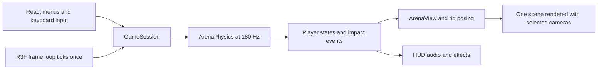

# Wankai Collaborator and Agent Handoff

Updated 19 October 2026. Repository: [Gumssss/Wankai](https://github.com/Gumssss/Wankai). Default integration branch: **main**. This file is the starting brief for a collaborator and their coding agent: it explains the game, current behavior, code ownership, development commands, accepted decisions, open work and delivery process.

The initial smooth beagle integration was merged in [PR #1](https://github.com/Gumssss/Wankai/pull/1). The timed-hover game update, reusable character-production skill and this handoff belong to [PR #2](https://github.com/Gumssss/Wankai/pull/2). Check that PR and the current remote main before assuming a particular checkout contains the update. Gameplay commit **5bf5ae7** is the tested timed-hover baseline; later commits in that PR add handoff/documentation work.

## Start here

Wankai, displayed as **丸棍竞技场**, is a small offline 3D physics fighting prototype. Two people share one keyboard on a Mac. The defining rule is that **the weapon is also the means of ordinary movement**: powered swings push against the floor and carry the fighter. There is no separate walking controller.

The current source has three floating weapons and a paired beagle/body-and-ears loadout, an armory, four play modes, health/stamina, physical hits/blocks/clashes, independent duel cameras, audio/effects, pause and rematch. The next goal is deliberate, readable movement and combat for first-time players, rather than more features without acceptance.

The runtime uses Electron, React, React Three Fiber, Three.js and a custom fixed-step solver. Tripo and Blender create assets outside the running game; players do not need those tools, an AI account or API credentials. There is no online networking, AI opponent, controller support, progression system or packaged installer in this checkpoint. Windows/Linux have not been verified.

Read this file first, then [current status](PROJECT_STATUS.md) and the source/tests for the assigned task. Use [controls](CONTROL_SYSTEM.md) for detailed mechanics and [design handoff](DESIGN_HANDOFF.md) for decisions. Historical studies explain earlier ideas; they do not override current implementation or later user decisions.

## Get a working development environment

The verified baseline is macOS with **Node.js 22.12 or newer**, npm and Git. The lockfile selects dependency versions. Use npm rather than switching package managers or updating dependencies as part of an unrelated task.

For a new checkout:

```sh
git clone https://github.com/Gumssss/Wankai.git
cd Wankai
npm ci
npm start
```

The first install needs network access and downloads Electron. After dependencies are installed, normal launch/play uses local assets. Do not start by opening index.html directly.

| Command | Purpose |
| --- | --- |
| npm start or npm run dev | Start the Vite renderer and Electron development window together. |
| npm run dev:renderer | Start only the browser renderer at http://127.0.0.1:5173/. |
| npm run dev:renderer -- --port 5187 | Optional separate browser-review port; 5187 was used during beagle development, not a required project setting. |
| npm run dev:electron | Open Electron against the normal 5173 renderer. |
| npm test | Run the Node physics/session/camera/model regression suite. |
| npm run build | Build the renderer into dist/. |
| npm run preview:electron | Open the existing dist/ build in Electron; build first. This is a local preview, not an installer. |

Electron's development URL is fixed to 5173 in electron/main.cjs, and Vite uses strict port binding. An alternate browser port does not automatically change Electron. Check for an existing server and which checkout it serves before starting another or terminating somebody else's process.

On an existing checkout, inspect git status before switching branches or updating. Preserve someone else's changes. With a clean checkout, update main using git fetch origin and git pull --ff-only origin main. Use a separate checkout/worktree when another agent is actively editing the same files.

Blender is needed only for asset authoring. The existing setup uses Blender 5.2.2 LTS on Apple Silicon, a project launcher and bundled Blender Python. Other machines should verify their installed version and GLB export/import rather than assume the owner's application path exists. [BLENDER_SETUP.md](BLENDER_SETUP.md) records the working conventions and checks.

## Current player behavior

### Modes and controls

| Mode ID | Menu meaning | World and view |
| --- | --- | --- |
| duel | 双人对战 · 分屏视角 | One match, two independently controlled rear cameras; arena radius 19.35. |
| duel-fixed | 双人对战 · 固定视角 | One shared elevated fixed view; arena radius 6.45. |
| practice | 木桩练习 | P1 fights an idle P2 dummy using the shared view; radius 6.45. |
| solo | 单人自由视角 | One fighter, mouse orbit/zoom and radius 19.35. |

Each mode starts through the armory. Players choose independently, can choose matching loadouts and retain selections on rematch. Default duel pairing is P1 sword against P2 polearm.

| Action | P1 | P2 |
| --- | --- | --- |
| Continuous frontward swing in the facing plane | W | Up arrow |
| Continuous backward swing | S | Down arrow |
| Left/right weapon heading | A / D | Left/right arrows |
| Independent split-screen camera rotation | Q / E | Period / Slash, without Shift |
| Beagle timed-hover skill | F | Right Shift |
| Pause | Esc | Esc |
| Rematch during play | R | R |

W/S select a continuous rotation direction, not a fixed up/down pose. Both axes work together. From overhead, W swings toward the front and S toward the back; continuing through downward contact can raise and carry the body. Release retains momentum under gravity/damping; opposite input brakes before reversing. Opposite keys on the same axis cancel powered input. Airborne ordinary swings add no independent travel force.

Weapon heading and camera heading are separate. Do not make A/D rotate the camera as an incidental change. Split-screen renders one simulation twice; it must not tick the game separately for each viewport. Mouse camera controls belong to solo. Loss of focus or a hidden tab clears input and pauses.

The split cameras start behind each fighter with a 15-degree offset, 0.35-radian orbit pitch, 55-degree field of view and 10.5-unit distance. Framing guards protect the player's own fighter; they do not guarantee the opponent and full weapon are always visible.

### Loadouts and combat

| Loadout ID | Role and current distinctions |
| --- | --- |
| sword | Short reach, fast response. Axis limit 6.1 rad/s. Guard geometry participates in contact; decorative flame detail does not add coverage. |
| polearm | Longer reach. Axis limit 4.25 rad/s. Measured shaft/collar/blade/barb contacts follow the local asset. |
| hammer | Slower response and greater inertia. Axis limit 3.4 rad/s. Solid head participates in support/hits/clashes and receives a 30% head-damage bonus; hanging cloth is cosmetic. |
| beagle | Smooth orange/tan-and-white dog with two long head-mounted weapon ears. Upright normal strokes and a separate timed rotor/hover ability. |

Current speed limits are the approved half-speed trial, with visual reach and acceleration/braking retained. They remain balance values, not final competitive tuning. Ordinary weapon parameters live in WEAPONS; beagle geometry/profile lives separately.

Each fighter has **100 HP** and **200 stamina**. Ordinary swing input costs 20 stamina/s, turning costs 8/s and both together cost 28/s. Recovery starts after 0.5 seconds without normal weapon input at 30/s. Below 25 stamina, powered strength/driven speed weakens toward 40% at zero; braking, passive motion, support and blocking remain. Camera input is free. Paused/countdown/hit-freeze periods do not advance the physical stamina clock.

Damage uses incoming relative contact-point speed and recent net drive acceleration. Light contacts below 1.65 m/s do no damage. Base damage is capped at 34 before the hammer-head multiplier; the resulting hammer head cap is 44 after rounding. Head and torso receive the same damage. Pure yaw-driven horizontal impact gets 50% of equivalent vertical damage; mixed contacts blend actual incoming yaw/pitch/translation contributions, including inertial hits after key release. Do not substitute current key state for contact motion.

Repeated overlap is gated rather than awarding damage every step. Two ears share one logical attack gate and ordinary stamina budget. Clear weapon clashes physically deflect both weapons and apply backward recoil opposite each fighter's own facing, with separation/cooldown rearming. Do not use the camera direction or collision normal as a replacement for that requested recoil direction. Body hits and clashes have different feedback; extra clash pause/readouts remain unimplemented.

Arena boundaries constrain bodies; falling off is not the win condition. A fighter loses at zero HP. The practice dummy stays passive, retains at least 1 HP and recovers health after it has not been hit for 2.5 seconds.

### Beagle behavior to preserve

The accepted appearance is the earlier smooth Tripo source, refined into model v05 in Blender. Preserve the round face, markings, proportions, curved ears and rounded tips. The fluffy/scalloped branch was rejected.

Normal W/S rotates parallel ears at measured head sockets; A/D can steer simultaneously with a normal target of 1.15 rad/s. Ground contacts produce ordinary lift/travel. The body stays upright.

Tap F, or P2 Right Shift, to start **five seconds including preparation/spin-up** of full sideways deployment, whole-body-and-ear rotation and low hover. Rotor speed targets up to 4.25 rad/s; feet target about 0.35 world units above the floor. Bounded physical lift depends on deployment/rotor readiness, and impacts can alter it. The timer continues when the key is released. Repeated presses cannot extend it, and holding cannot automatically recast. Expiry removes lift, retracts the ears and lands; a fresh edge after retraction can activate again. There is no added cooldown in this prototype.

The skill and its A/D steering cost **no stamina**, work at zero stamina and do not weaken with ordinary fatigue. Ordinary stamina can recover during it. W/S strokes pause while deployed/retracting. Pause freezes the timer; rematch/menu resets it. Other loadouts ignore the skill keys.

**Front and back flips are inactive.** The user reported the articulated experiment lying down and set it aside. src/beagle-dynamics.js and the old flip studies remain historical/isolated test material; the production controller does not import that module. Do not restore flips because an older document or video requests them.

The rigged GLB, fallback geometry and physical capsules use the same pitch/spread/lag/heading transform. Root lag is small controlled secondary motion, not an unrestricted floppy chain. The two ears have separate roots/contacts but share their ordinary swing command, motor budget and repeat-hit handling. Full details are in [BEAGLE_SPIN_SKILL.md](BEAGLE_SPIN_SKILL.md) and [BEAGLE_MODEL_V05.md](BEAGLE_MODEL_V05.md).

## How the code works



| File or area | Responsibility and editing guidance |
| --- | --- |
| src/main.jsx | Mounts the React application. |
| src/App.jsx | Owns the shared GameSession instance, menus, HUD/help/dialogs and browser keyboard/focus bindings. Uses session snapshots for React UI. |
| src/game-session.js | Input mapping, selections/mode, lobby/countdown/playing/paused/ending/result states, fixed-step accumulator, hit-freeze, audio/events, resets and snapshots. |
| src/physics.js | Authoritative game rules: CONFIG, WEAPONS, STAMINA, CLASH, contact transforms/velocities, motors, ground/rim/body impulses, attacks, clashes, damage and repeat-hit rules. Keep it renderer-independent. |
| src/ArenaCanvas.jsx | R3F Canvas and frame bridge. Calls session.tick once, loads local GLBs, updates the view and renders one/two viewports. Handles renderer context loss and lifecycle. |
| src/scene.js | ArenaView: scene/fighters/fallbacks, model attachment, trails/particles, camera orchestration, projection and resource disposal. Visuals follow physics rather than moving the solver. |
| src/free-camera.js | Solo/split orbit, facing-independent camera input, tracking, resize and framing protection. |
| src/weapon-catalog.js and src/Armory.jsx | Player-facing loadout descriptions, actual-model previews and independent equipment selection. A new loadout also needs physics/import support. |
| src/weapon-visuals.js | Measured native model axes, grip alignment and continuous yaw/pitch orientation. Do not infer pivots from a screenshot. |
| src/beagle-profile.js | Generated measured model name, sockets, dimensions, motor values and eighteen fitted ear capsules. Regenerate after relevant geometry edits. |
| src/beagle-skill.js | Active timed skill lifecycle, hover and authoritative beagle point transform/Jacobians, including spread and lag rates. |
| src/beagle-model.js | Independent skeleton/material instances, imported rest transforms, game-driven posing, blink and procedural fallback. |
| src/audio.js and src/style.css | Synthesized Web Audio feedback and application styling/layout. No downloaded runtime audio service. |
| electron/main.cjs | Sandboxed desktop shell and dev/built entry. Node integration is off; context isolation and sandboxing are on. No gameplay IPC bridge. |
| tests/ | Node tests for physics, contacts, loadouts, damage/stamina, recoil, sessions, cameras, actual GLB posing and the beagle skill. |
| scripts/blender/ and scripts/preview/ | Authoring, asset verification, contact fitting and offline motion studies. These are not required to play. |
| public/models/ | Self-contained runtime GLBs loaded locally. |
| assets/source/ and assets/concepts/ | Editable authoring sources, reference/provenance and measured reports; some large raw files are intentionally archived outside Git. |

GameSession clamps large render deltas and accumulates time into CONFIG.step = 1/180 second, with a bounded substep count. ArenaPhysics steps once per accumulated tick. Rendering speed or viewport count must not change the physical clock.

Weapon/body contacts use positions and point-velocity derivatives so impulses affect translation and rotation together. Current weapon contacts are rounded capsule approximations. Between-pose sampling helps catch fast crossings, including ear deployment/lag, but is bounded and does not guarantee every grazing contact. Do not inflate all hitboxes to mask a transform or sampling error.

The game world uses +Y up. Native weapon axes are asset-specific; the beagle is authored +X forward, with Blender +Z up converted to glTF +Y up. Preserve bind/rest quaternions and correct origins. A visual skeleton supplies deformation controls, not a physics controller by itself.

## Asset and character production rules

New character production uses the included [game-character-pipeline skill](../skills/game-character-pipeline/SKILL.md). Read that file directly if the skill is not installed. The eight older project skills in the owner's parent workspace are not automatically part of a GitHub clone; the included pipeline is portable and links to its own references.

For discoverable installation on another agent's machine, run the following from the repository root. It creates a new skill folder and deliberately refuses to overwrite an existing one:

```sh
python3 - <<'PY'
import os
import shutil
from pathlib import Path
codex_root = Path(os.environ.get('CODEX_HOME') or (Path.home() / '.codex'))
destination = codex_root / 'skills' / 'game-character-pipeline'
shutil.copytree(Path('skills/game-character-pipeline'), destination)
print(destination)
PY
```

If already installed, inspect/update that copy deliberately. Invoke it as **$game-character-pipeline**. It can use available character-design, create-game-assets, rigging, model-loading and debugging tools; do not require an unavailable MCP bridge when Blender Python or signed-in browser access is usable.

The user's required workflow is:

1. Read the actual game and preserve the selected reference. Write a provisional design brief, manifest and functional plan before generation.
2. **Always use videos to present the understanding of every move**, including familiar controls, combinations, abilities, transitions, landing and recovery. Use cheap blockouts/solver replays before final modeling; label authored concepts and test-launch forces honestly.
3. Approve the direction/motion and exact reconstruction packet. Choose consistent generation views based on the actual design/current Tripo mode; exactly three images are not mandatory.
4. **Always generate a new production character base in Tripo.** Review the actual downloaded 3D candidate, not just the concept image. Reuse an approved Tripo base for later edits instead of regenerating identity unnecessarily.
5. Refine/optimize/rig in Blender. Keep originals and visual locks, document coordinates/pivots/control ownership, fit contacts, reimport with the real loader and show move videos. Review the finished asset before integration.
6. Implement the accepted character/loadout and show **actual gameplay videos** covering the approved actions. Verify contacts, multiple instances, modes, reset paths and the complete action's recovery.
7. Update the design, plan, motion/video record, manifest/provenance, model/runtime handoff, verification and history. Reuse existing documents for small changes.

User approval and credit authorization persist within their actual scope. Prepare concrete artifacts before requesting an unresolved decision, combine reviews where useful and do not ask repeatedly for routine cleanup/export/test permission. A prior beagle credit authorization is not an unlimited budget for a new character. Do not silently bypass Tripo or required videos if tooling is unavailable.

Use simplified runtime contacts rather than high-detail render meshes. Body-mounted weapons need anatomical sockets, while deliberately detached weapons can use their approved constraints. More appendages must not automatically multiply damage, stamina charges or motor power. Keep authored cosmetic tracks from overriding physically controlled bones.

The selected beagle runtime is public/models/beagle-smooth-ear-duelist-v05.glb, with the editable packed rig at assets/source/blender/beagle-smooth-ear-duelist-v05.blend. The original large Tripo downloads are excluded from Git; rebuilding from raw segmentation requires restoring them. Included GLB/contact verification works without those raw sources.

Existing static-weapon preparation scripts assume inspected static GLB layouts and reject skins; they are not a universal character optimizer. Python 3 and Pillow support those scripts. New rigs need the Blender/skinned-GLB path instead.

## What is finished and what remains open

| Status at this checkpoint | Meaning for the next agent |
| --- | --- |
| Playable | Four modes, armory, three weapons, smooth beagle, shared keyboard, independent duel cameras, 200 stamina, damage/blocks/clash recoil and timed F hover. Preserve these unless the task explicitly changes them. |
| Verified | Exact gameplay snapshot passed 100 tests, renderer build, beagle rig import and functional-preview simulation. Skill metadata/links/templates and included document links were checked. This is the baseline, not proof of final balance or native packaging. |
| Beagle playtest pending | Judge normal steering, long-ear coverage, ground lift, rotor wind-up, five-second timing, free skill use/rearming, landing and match balance. Keep flips inactive. |
| Sword support complaint open | The owner still finds its support-direction behavior wrong. Reproduce exact keys, pose, mode and camera; compare polearm under the same view. Existing rotation tests do not establish user acceptance. |
| Contact/recoil balance pending | Half-speed limits, measured proxies and swept sampling are implemented. Evaluate deliberate blocks, near misses, impact strength and backward recoil before adding forgiveness or changing tuning. |
| Two-person acceptance pending | Have two unfamiliar players try deliberate movement, aiming and hits without live coaching; distinguish accidental contact from understandable control. |
| Performance measurement pending | Start with repeated armory/mode transitions and the sword's three 4K textures. The roughly 256 MiB decoded RGBA/mipmap estimate is not a GPU measurement or proof of a leak. |
| Orange cat local research | Separate unpublished work, summarized below. It is not a fifth playable loadout and its files are outside this checkpoint. |
| Deferred | Fourth precision weapon, global 30% speed option, extra clash pause/readout, guided tutorial, networking, AI, gamepad and installer. Do not implement or buy these merely because old notes mention them. |

The fourth precision weapon's proposed appearance/export remains unapproved and no export was purchased. See [PRECISION_WEAPON.md](PRECISION_WEAPON.md) before resuming that specific side project.

### Orange-cat work in the separate task

The original request was an orange tabby with paw/claw weapons, based on an orange-striped cat and a white paw with pink pads/small claws. Subsequent user revisions superseded anatomical attached paws and a standing pose. **The latest local direction is a seated cat with much larger detached floating paw weapons, with no visible limb connectors.**

The latest inspected v03 research packet has authored design footage and isolated game-solver controls/combat replays, not an integrated character. It covers ordinary keys/combinations, reversal, landing, hits, a clash and a miss. Large contact volumes still produce excessive rise/drift/passive motion; exact motion/proportion acceptance remains pending. No extra cat ability is selected, no Tripo operation has been submitted, and there is no production rig, runtime GLB or cat loadout.

Those assets, references and local handoff are not included in this beagle/skill checkpoint. A collaborator should not assume a clone contains them or recreate the superseded standing/attached direction. Before resuming cat production, obtain the current review packet/user decisions from the owner and continue the required input/Tripo/asset reviews. Existing runtime work can proceed independently.

## Verification and debugging

Run focused checks while changing mechanics, then the required suite and build for a playable delivery:

```sh
npm test
npm run build
node scripts/blender/verify-beagle-tripo-v05.mjs
```

The rig check is relevant to beagle/model changes; do not run unrelated authoring renders for a simple UI edit. The historical proxy preview can be reproduced with node scripts/preview/beagle-functional-preview.mjs. The normal/skill comparison script relies on the recorded baseline commit and Git history.

The current 100-test suite includes:

- Physics stability, damage, contact-driven support, loadout selection and all sixteen existing loadout pairs.
- Speed limits, added solid features, between-step crossings, near misses and heading wrap.
- Stamina drain/recovery/fatigue, directional damage and clash recoil/rearming.
- Session modes, input cancellation, pause/focus/reset, cameras and framing.
- Actual imported GLB/socket/contact alignment, independent skeletons and ear spread/lag.
- Timed hover, no-cost zero-stamina activation, reversal, expiry/landing, repeated/held-key handling and independent P1/P2 keys.

The build currently emits an existing large-chunk warning. Do not call that warning a failed build, and do not claim the warning is resolved without changing and measuring the bundle.

For visible changes, inspect actual browser/Electron behavior in relevant modes, including pause/rematch, focus loss, resize, matching instances and offline asset loading. For a changed move, provide the required before/after videos. Browser checks do not prove native Electron lifecycle or installer behavior.

The application exposes read-only development helpers in its renderer console:

```js
window.__arena.snapshot()
window.__arena.rendererInfo()
```

The snapshot includes session/mode/loadouts and physical player state. Renderer counts cover the arena renderer, not texture bytes or the armory's separate renderer. Do not infer a memory leak from one count or a frame-rate result from asset byte size.

For a bug, record mode, loadouts, camera/view, exact key sequence, starting pose, expected result and actual result. Inspect the relevant transform/state and recent changes, reproduce the failure, then make a minimal evidenced fix with a regression where appropriate. A physical mismatch needs shared pose/velocity/contact correction rather than a render-only offset. Test misses as well as hits.

## Work with another collaborator or agent

At the beginning of a task, inspect the current remote main, local branch and dirty/staged files. Choose a focused task from the assigned request and current status. If no implementation task was assigned, establish the baseline and reproduce an actionable open issue before proposing a feature. Do not silently restart deferred work.

Keep one task per branch. Prefer a separate checkout/worktree for parallel agents sharing a project; branches alone do not isolate a shared working directory. Never reset, clean, stash or commit another worker's changes to obtain a clean tree. Do not stop their development server without coordination.

For a clean checkout, a typical starting sequence is:

```sh
git status --short
git fetch origin
git switch main
git pull --ff-only origin main
git switch -c feat/collaborator-task
```

Choose a distinct descriptive branch name when that example already exists or when several tasks run concurrently. If the tree is dirty, preserve it and isolate/coordinate before switching or pulling.

Before committing, inspect the diff and stage only files for the task. Use explicit paths, inspect the staged diff and ensure no raw private downloads, credentials, node_modules, build output, local preferences or unrelated prototypes entered the commit. Keep editable/runtime sources and meaningful verification where repository policy expects them. .gitignore describes large beagle-source exclusions and generated output.

For a task authorized for GitHub delivery, complete the code/assets/docs and relevant checks, then push the branch and open a PR against main. Use a body file with actual newlines for gh, or a structured tool argument. Describe the problem/result, validation and material limits. Do not publish abandoned experiments as active features.

Example publishing commands after a scoped commit, on the task branch:

```sh
git push -u origin HEAD
gh pr create --base main --title "Describe the completed change" --body-file /tmp/wankai-pr-body.md
gh pr view --json number,url,headRefOid,baseRefName,mergeStateStatus
gh pr checks
git rev-parse HEAD
```

Create /tmp/wankai-pr-body.md with the actual review description before running that example. Check the PR targets main, its head matches the tested commit, and required branch checks/reviews are satisfied. There is no checked-in GitHub Actions workflow in this snapshot; local verification is still required, and future repository rules take precedence over that historical observation.

When merging is authorized and the requirements are satisfied, use the actual reviewed PR number and exact tested head SHA with gh pr merge's --merge and --match-head-commit options, or the equivalent structured GitHub tool. If main moves and conflicts affect the change, resolve them deliberately and rerun the relevant checks before merging. Do not force-push main, bypass protection or use an admin override to evade requirements. Missing write/merge access must be resolved with the owner rather than borrowing credentials.

If Codex exposes attach_artifact, attach every created PR to the task. Verify the remote PR reports merged and fetch the resulting main before claiming delivery. Update a clean local branch using fast-forward only. Keep the feature branch until it is no longer needed by collaborators; deletion is not required for delivery.

Once merged, tell the collaborator the PR URL, merge commit, changed behavior, checks and remaining limitations. A push to a feature branch is not a merge; a merge is not a packaged application release.

## Keep progress discoverable

After a meaningful milestone, update [PROJECT_STATUS.md](PROJECT_STATUS.md), the relevant runtime/model handoff, current controls/help and [CHANGELOG.md](../CHANGELOG.md). For character work, also keep its manifest, selected-version pointers, provenance, move-video review record and decision history current.

Use separate status descriptions: proposed, selected appearance, technically verified, playable implementation, user accepted, pushed/merged and packaged/released. Include the date, source revision, actual commands/results, evidence paths and open issues. Historical test counts and screenshots stay attached to their dated checkpoint rather than replacing current verification.

Do not claim a user decision that was not given. Preserve accepted design choices and later corrections; require concrete reviews only for unresolved or changed decisions. The complete beagle account is [BEAGLE_DESIGN_PROCESS.md](BEAGLE_DESIGN_PROCESS.md), while [CHARACTER_CREATION_WORKFLOW_SPEC.md](CHARACTER_CREATION_WORKFLOW_SPEC.md) and the included skill define the reusable production process.

Known original-cartoon and public-model reuse/redistribution questions remain in the asset provenance. A GitHub source checkpoint does not establish those permissions. Keep source records intact, and resolve the relevant terms before treating a prototype asset as cleared for a wider release.

## Prompt the collaborator can give their agent

> Work in the Gumssss/Wankai repository. Read docs/COLLABORATOR_AGENT_HANDOFF.md, then the current project status and the source/tests relevant to my task. Inspect the latest origin/main and preserve unrelated local work. Implement the task I assign using the existing weapon-driven movement, authoritative physics/visual transforms and accepted character decisions. For new or changed moves, show your understanding through videos before runtime implementation and provide actual gameplay footage afterward. For a new character, use the included game-character-pipeline skill, generate its production base in Tripo and refine/rig it in Blender. Reuse existing approvals, prepare concrete artifacts for unresolved design reviews and keep progress documents current. Run the appropriate checks, push a focused branch, create a PR and merge it into main when repository requirements are satisfied. Verify the remote merge and report the PR, commit, validation and remaining limitations. If I have not assigned a feature, first reproduce and investigate an actionable open issue from PROJECT_STATUS.md rather than inventing an unapproved feature.
