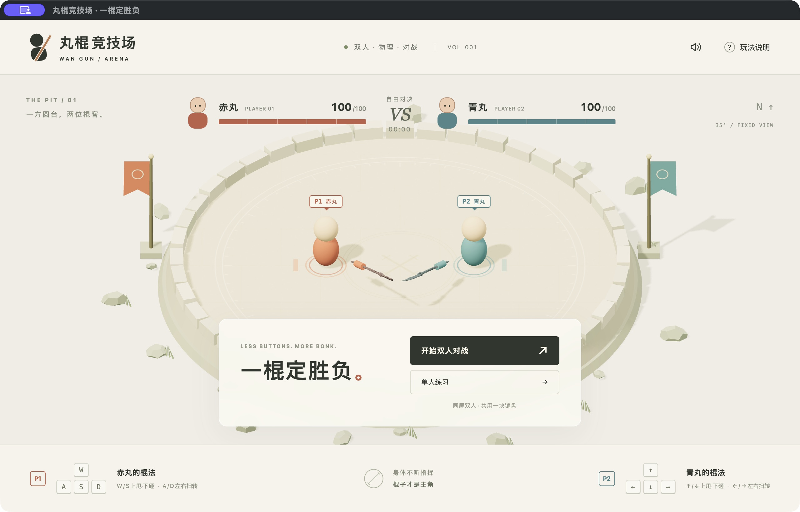

# First Tripo weapon trial

Status: Historical record of the first polearm import on 13 October 2026, reviewed 17 October 2026. The polearm remains playable in the current three-weapon armory. Shape, visibility, and performance still need a two-player playtest. Current setup and behavior are in the [README](../README.md), [project status](PROJECT_STATUS.md), and later [sword](SWORD_TRIAL.md) / [hammer](HAMMER_TRIAL.md) trials.

The later local half-speed/contact trial retains this GLB and its original normalization. It adds measured collar/blade/tip/barb capsules around the original shaft and samples motion between physics poses; those gameplay changes are separate from the original appearance-only import described below. See [control system](CONTROL_SYSTEM.md) for current collision behavior and limitations.

## First model result (13 October 2026)

- [Tripo model page](https://studio.tripo3d.ai/zh/workspace/generate/d70e3616-deab-424a-a97c-1e12ca05869f) (private to the creator's account): generated from the single supplied image using H3.1 High Quality. This generation used 30 account credits.
- The [original GLB](../assets/source/wankai-polearm-first-pass.glb) is 47,526,652 bytes (about 47.5 MB), with 1,980,223 triangles, 990,114 vertices, one material, and no embedded texture. Its geometry resembles the reference polearm, but its hidden side and surface finish remain guesses from one image.
- The [game GLB](../public/models/polearm.glb) is 1,921,308 bytes (about 1.9 MB), with 79,997 triangles. After `npm ci`, `node scripts/optimize-weapon.mjs assets/source/wankai-polearm-first-pass.glb public/models/polearm.glb` recreates it using `MeshoptSimplifier` bundled with Three.js. This script targets the inspected untextured polearm layout; use the separate preparation scripts for textured assets.
- The original appearance-only trial loaded that local game copy for both players. The current default is sword versus polearm; select the polearm for both players in the armory to repeat the original pairing. Colored grips and a subtle tint distinguish them. Loading this GLB does not change the selected profile's collision or control calculations; the continuous swing controller is a separate change. If loading fails, the procedural weapon remains visible.
- This first export is untextured, so it does not reproduce the silver blade or detailed fittings in the reference image. Check its readability and the curved blade's visual mismatch with the straight collision rod during playtesting.
- In the Electron development window, both weapons rendered in the arena. A local two-player start, rematch, pause, and practice start were checked. Longer play, frame rate, and offline startup still need hands-on verification.

This screenshot predates the armory, current cameras, stamina bars, and directional damage. Current screenshots and validation are linked from the [project status](PROJECT_STATUS.md).

## What we are testing

Use the [polearm reference image](reference/polearm.png) to generate one 3D weapon. Put that weapon on both fighters' existing moving staffs in Wankai. This first pass tests whether a generated model looks and moves convincingly in a playable match. Final weapon design and precise visual alignment can follow later.

The reference is a **2D PNG image**. Wankai cannot use it as a 3D weapon by itself. Tripo's image-to-3D workflow can turn it into a **3D model**; export **GLB** for this trial. A GLB can contain the mesh, materials, and textures in one file. Wankai uses React Three Fiber and Three.js inside Electron, so it can load a local GLB. Electron supplies the desktop window; Three.js renders the model.

## Historical generation and export workflow

These steps describe asset authoring, not player setup. The exported game models are already included in the repository. Tripo's interface, model options, and credit costs can change; the recorded 30-credit generation is a past transaction. Inspect the current preview and cost and obtain the creator's approval before a future purchase.

1. Sign in to [Tripo](https://www.tripo3d.ai/) and open its **Image to 3D** workflow.
2. Upload [the supplied polearm image](reference/polearm.png). This trial used one image. If a future export has a flattened blade, invented back, or distorted shaft, inspect whether consistent additional views of the **same** object would help; do not mix weapon designs.
3. Generate a model. Review it from several angles. In particular, check that the shaft is continuous, the blade is recognizable, and the back of the weapon is usable. A single reference image may leave hidden surfaces to the generator's interpretation.
4. Export the result as **GLB**. If Tripo offers a choice of mesh detail, start with a moderate setting suitable for a real-time game. Keep the original download unchanged.
5. Put the exported GLB in the project, inspect its size, orientation, pivot, materials, and texture, then make an optimized game copy if needed. The first model's result and paths are recorded above.

Generation happens in the Tripo account and may use the account's credits. Wankai does not need a Tripo account, API key, or network connection to run a model that has already been exported and stored locally.

## Integration in Wankai

1. Keep the exported GLB as a local game asset and load it with Three.js's glTF loader through the existing React Three Fiber scene.
2. Attach a copy to each fighter who selected that weapon. Measure the native longitudinal axis and grip origin, set them independently in `src/weapon-visuals.js`, and scale to the selected physics length. Preserve continuous yaw × pitch for rendering and contacts through both vertical poles. A player-color accent distinguishes matching weapons.
3. Leave `src/physics.js` and its staff collision shape authoritative. The GLB changes **appearance only**. The blade may initially extend beyond the straight collision rod; note that mismatch during testing and refine the art or collision design only after the proof of concept.
4. Keep the procedural staff as a fallback if the model fails to load. Check a match and a rematch for correct movement, visibility, performance, and resource cleanup. Confirm the app works offline once the asset is present.

## First-trial success check

Both players can see the generated weapon follow their existing staff motion in a local match. They remain easy to tell apart, the original controls and collisions still work, and a rematch does not duplicate weapon models or loading work.

## References

- [Tripo Image to 3D workflow](https://www.tripo3d.ai/features/image-to-3d-model)
- [Tripo multi-view input guidance](https://www.tripo3d.ai/help/features/how-to-use-multi-view-input-effectively)
- [Tripo supported export formats](https://www.tripo3d.ai/help/getting-started/what-3d-file-formats-do-you-support)
- [Three.js guide to loading 3D models](https://threejs.org/manual/pages/loading-3d-models.html)
